# git-practice

## 1. 概要

Git初心者が、Gitの基本的な仕組みを理解し、TortoiseGitで開発現場に必要な基本操作を身につけるための学習教材。

## 2. 学習ロードマップ

| STEP | 学習テーマ |
|---|---|
| 1 | Gitの基本 |
| 2 | ファイルの変更管理 |
| 3 | 変更の取り消し |
| 4 | ブランチによる作業の分割 |
| 5 | マージによる変更の統合 |
| 6 | 複数人での変更共有 |
| 7 | GitHubとプルリクエスト |
| 8 | Git操作を体験する |

## 3. 学習のゴール

学習を終えたとき、次のことができる状態を目指す。

- Gitの基本的な仕組みを説明できる
- TortoiseGit（Gitで使用するツール）で基本的な操作ができる
- 変更履歴を確認できる
- 変更を記録・取り消しできる
- ブランチを使って作業を分けられる
- 複数の変更を統合できる
- 他の人と変更を共有できる
- 競合が起きたときに解消できる

## 4. ディレクトリ構成

| ディレクトリ | 内容 |
|---|---|
| `docs/教科書/` | Gitの仕組みや操作方法を学ぶ教材 |
| `docs/課題/` | 教科書で学んだ内容を実際に操作して試す課題 |

## 5. 環境構築手順

教材を始める前に、次の4つを順番に済ませる。画像は `docs/images/` に置く。

1. Git を入れる(5-1)
2. TortoiseGit を入れる(5-2)
3. TortoiseGit を日本語にする(5-3)
4. GitHub のアカウントを用意する(5-4)

### 5-1. Git のインストール

Git は、ファイルの変更履歴を記録してくれるソフトだよ。この教材の主役で、先に入れておかないと TortoiseGit が動かない。

#### ダウンロード

1. ブラウザで Git for Windows の公式サイト(https://gitforwindows.org/)を開く。

   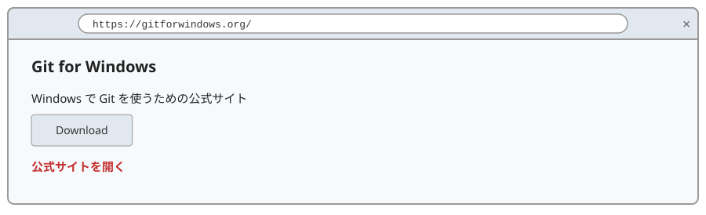

2. 「Download」ボタンを押す。ソフトの配布ページ(GitHub)が開く。

   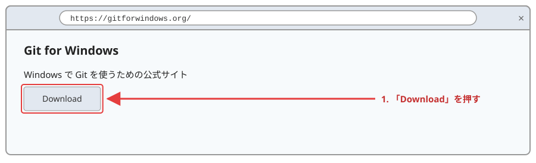

   ページを下へ進み、「Assets」の一番上にある「Git-バージョン-64-bit.exe」を押して、インストーラーをダウンロードする。

   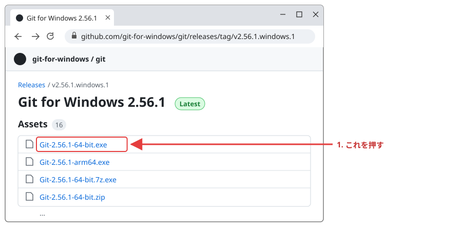

#### インストール

3. ダウンロードしたインストーラーをダブルクリックして起動する。

   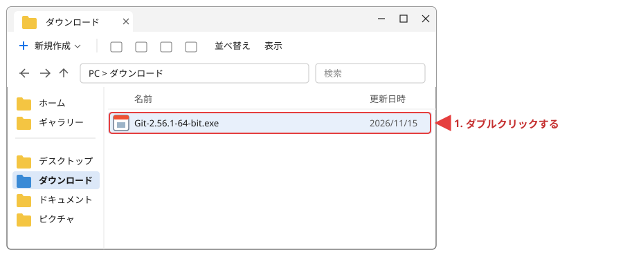

4. 使用許諾の画面で「Next」を押す。

   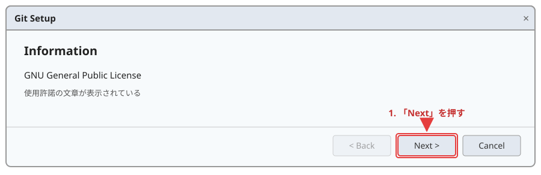

5. インストール先の画面で、何も変えずに「Next」を押す。

   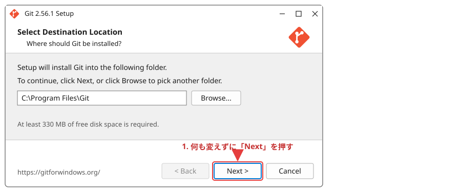

6. 部品の選択画面で、何も変えずに「Next」を押す。

   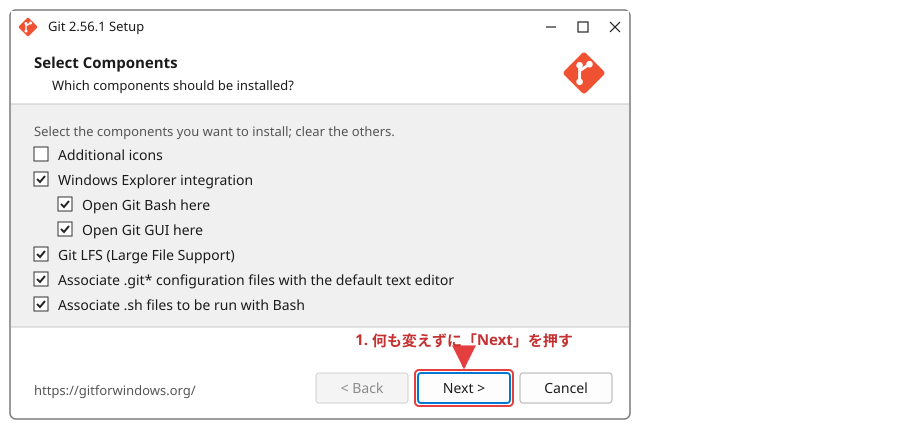

7. スタートメニューの画面で、何も変えずに「Next」を押す。

   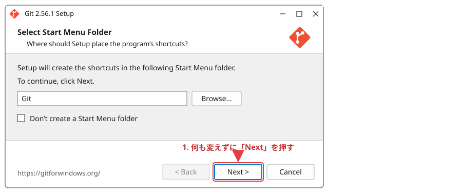

8. 文章を書くソフト(エディター)の選択画面で、「Notepad」を選んで「Next」を押す。
   - Git は、たまに文章を入力する画面を開く。初めてでも使いやすいメモ帳(Notepad)にしておくよ。

   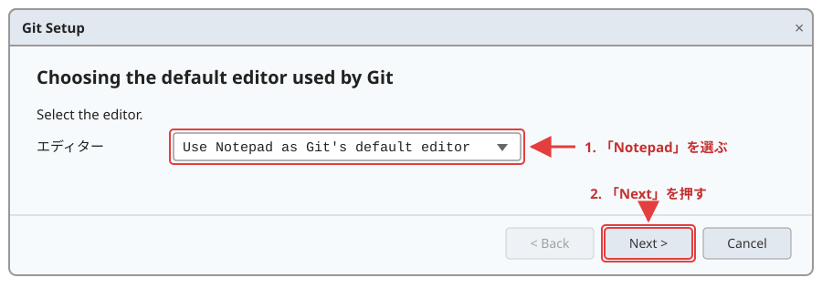

9. 最初のブランチ名の画面で、「Override the default branch name for new repositories」を選び、入力欄が `main` になっていることを確かめて「Next」を押す。
   - ブランチは作業の枝分かれのことで、教材の STEP 4 で学ぶ。今は「最初の枝の名前を main にする」と覚えておけば十分だよ。

   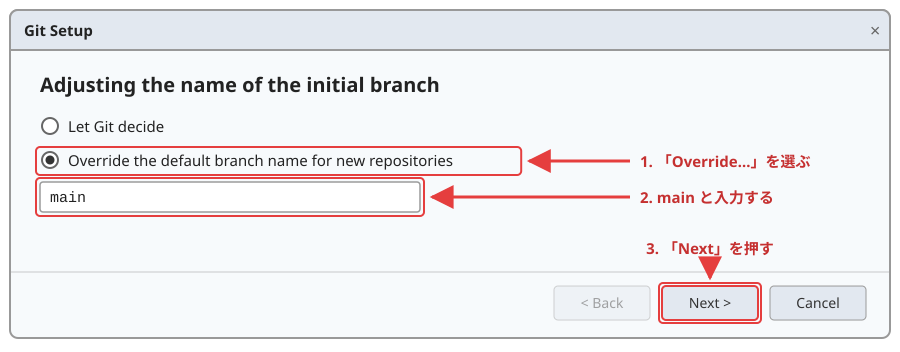

10. PATH の画面で、何も変えずに「Next」を押す。

    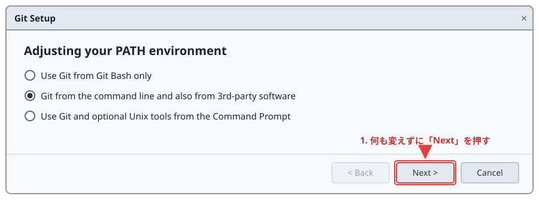

11. 残りの画面(SSH、HTTPS、改行の扱いなど)は、すべて何も変えずに「Next」を押して進める。

    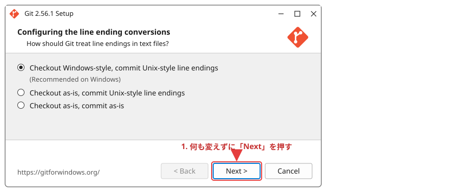

12. 「Install」を押す。

    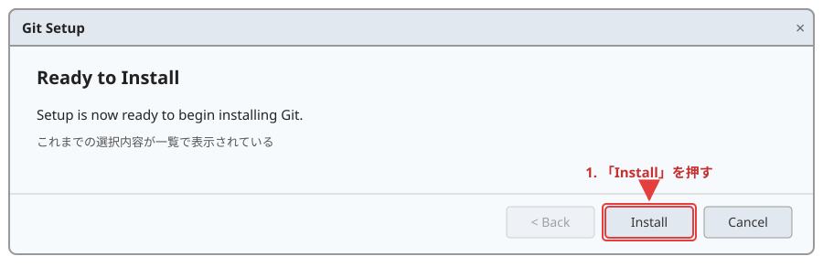

13. 完了画面で「Finish」を押す。

    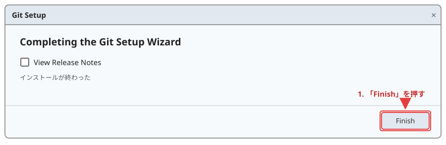

#### 設定

14. スタートメニューから「Git Bash」を開く。Git Bash は、文字で命令を打ち込む黒い画面だよ。

    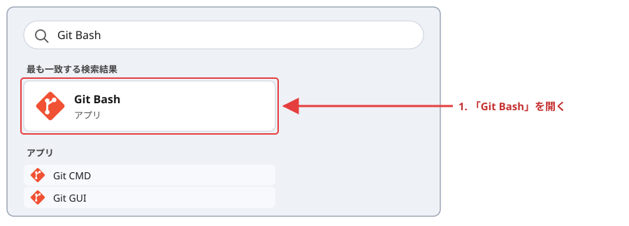

15. 次のコマンドを打って Enter キーを押し、バージョンが表示されれば、インストールは成功だよ。

    ```
    git --version
    ```

    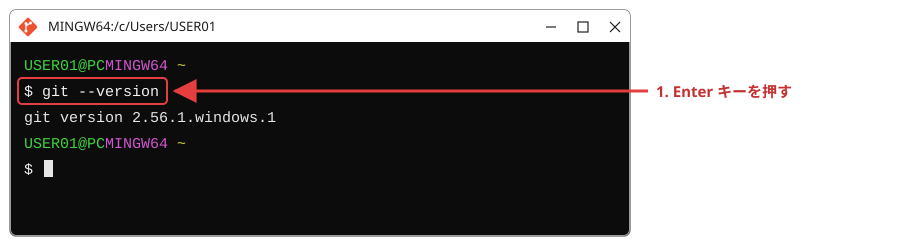

16. 変更履歴に残す名前を登録する。`あなたの名前` は自分の名前(ローマ字がおすすめ)に書き換えて、Enter キーを押す。

    ```
    git config --global user.name "あなたの名前"
    ```

    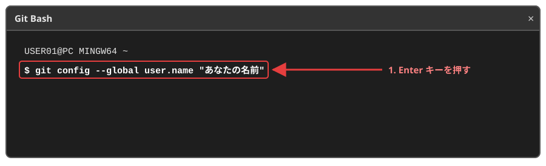

17. 変更履歴に残すメールアドレスを登録する。`you@example.com` は自分のメールアドレスに書き換えて、Enter キーを押す。

    ```
    git config --global user.email "you@example.com"
    ```

    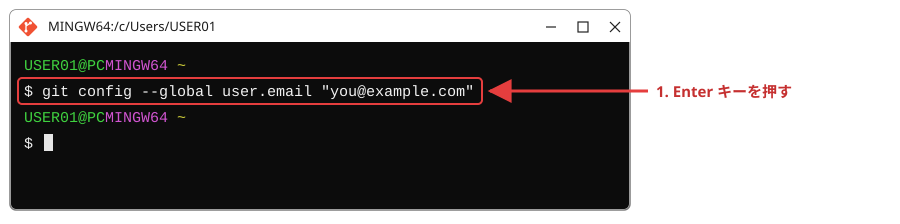

> [!TIP]
> **確認**
>
> - `git --version` でバージョンが表示された
> - 名前とメールアドレスを登録した

### 5-2. TortoiseGit のインストール

TortoiseGit は、Git をマウスで操作できるようにするソフトだよ。Git は本来、文字で命令を打ち込んで使う。TortoiseGit は、そのリモコンの役割をしてくれる。

#### ダウンロード

1. ブラウザで TortoiseGit の公式サイト(https://tortoisegit.org/download/)を開く。

   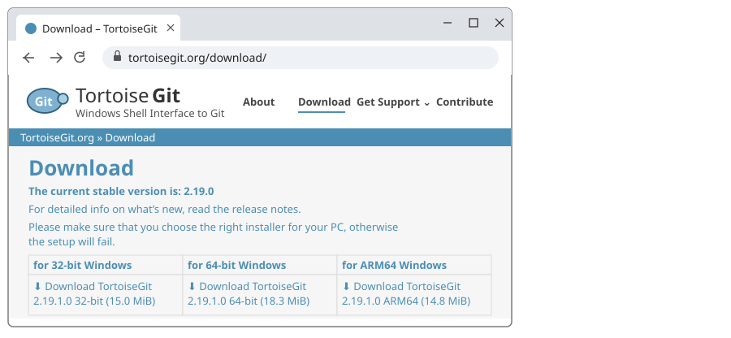

2. 64bit 版のインストーラーをダウンロードする。

   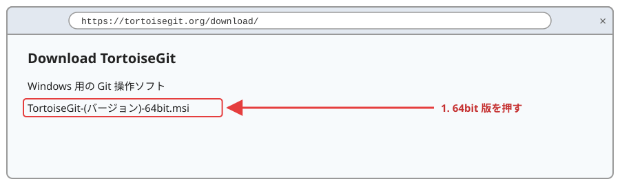

#### インストール

3. ダウンロードしたインストーラーをダブルクリックして起動する。

   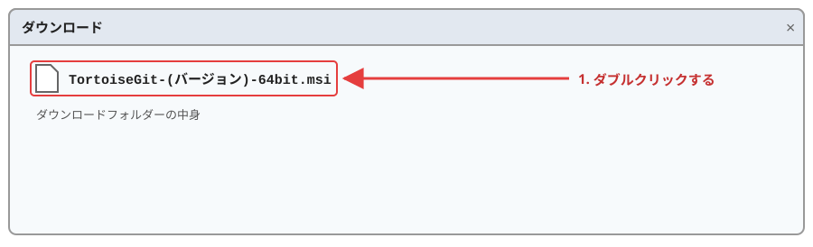

4. 最初の画面で「Next」を押す。

   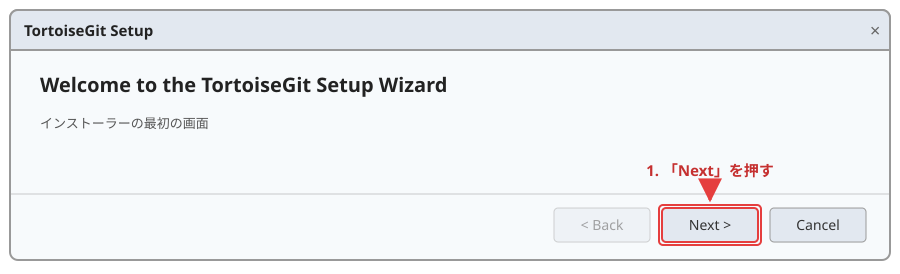

5. 使用許諾の画面で、内容を確かめて「Next」を押す。

   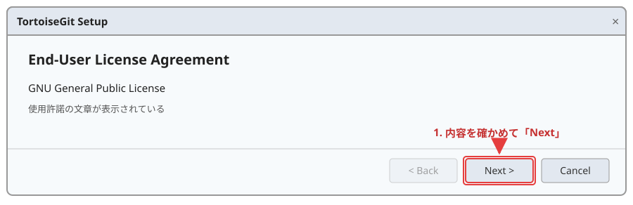

6. SSH クライアントの選択画面で、何も変えずに「Next」を押す。

   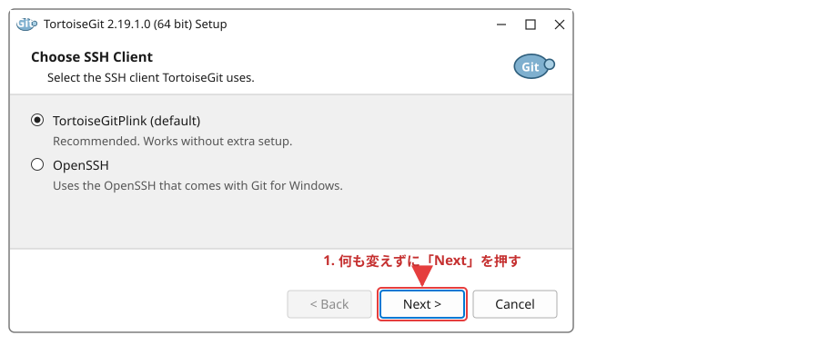

7. インストール先の画面で、何も変えずに「Next」を押す。

   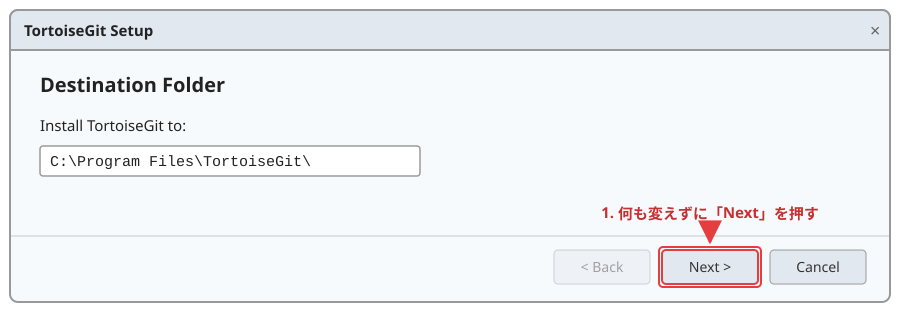

8. 「Install」を押す。

   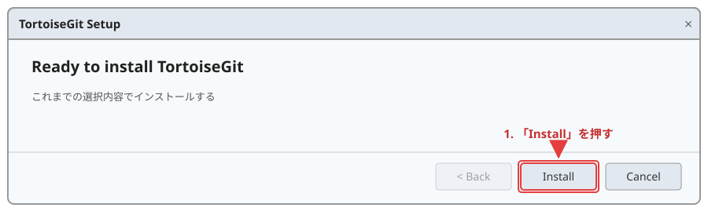

9. 完了画面で「Finish」を押す。

   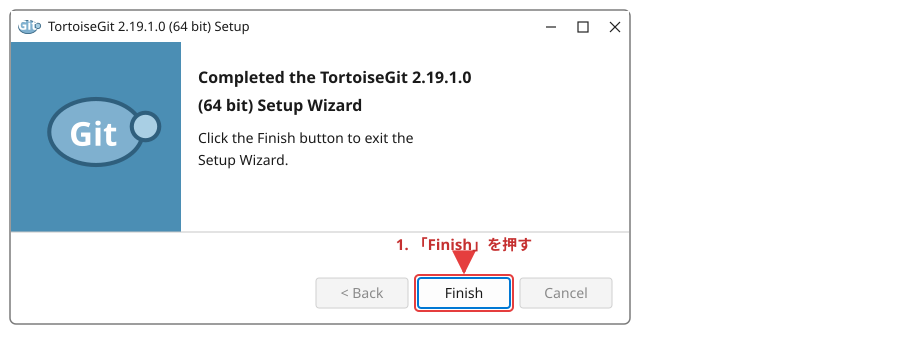

10. 再起動を求められたら、パソコンを再起動する。

    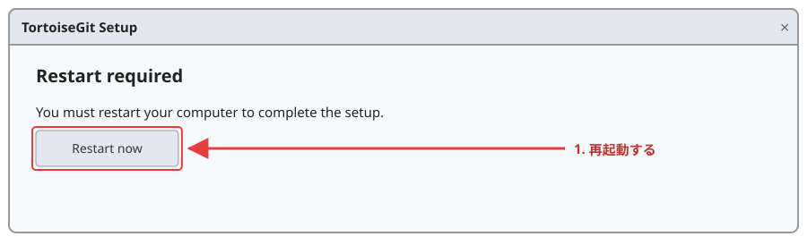

#### 設定

11. 初回設定の画面(ウィザード)が出たら、言語を「English」のまま「Next」を押す。日本語にするのは 5-3 で行う。

    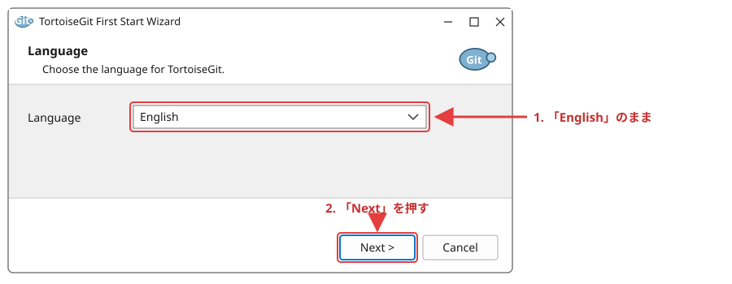

12. Git の場所を設定する画面で、場所が自動で入っていることを確かめて「Next」を押す。

    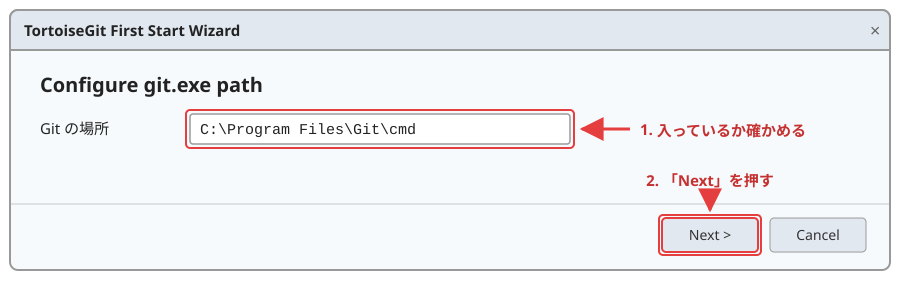

13. 名前とメールアドレスの画面で、5-1 で登録した内容が入っていることを確かめて「Next」を押す。

    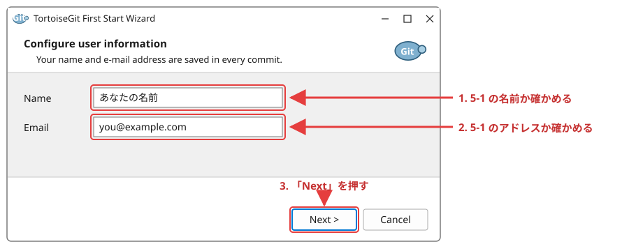

14. 認証の画面で、何も変えずに「Finish」を押す。

    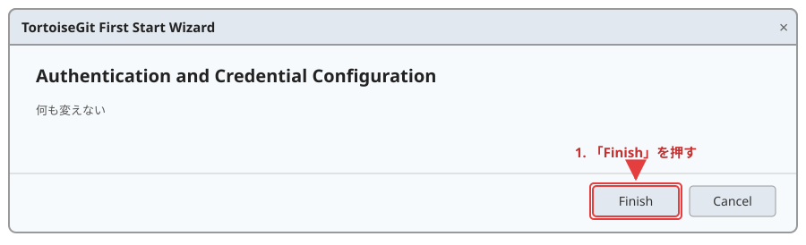

15. 適当なフォルダーの何もない場所で右クリックし、「TortoiseGit」というメニューが出ることを確かめる。

    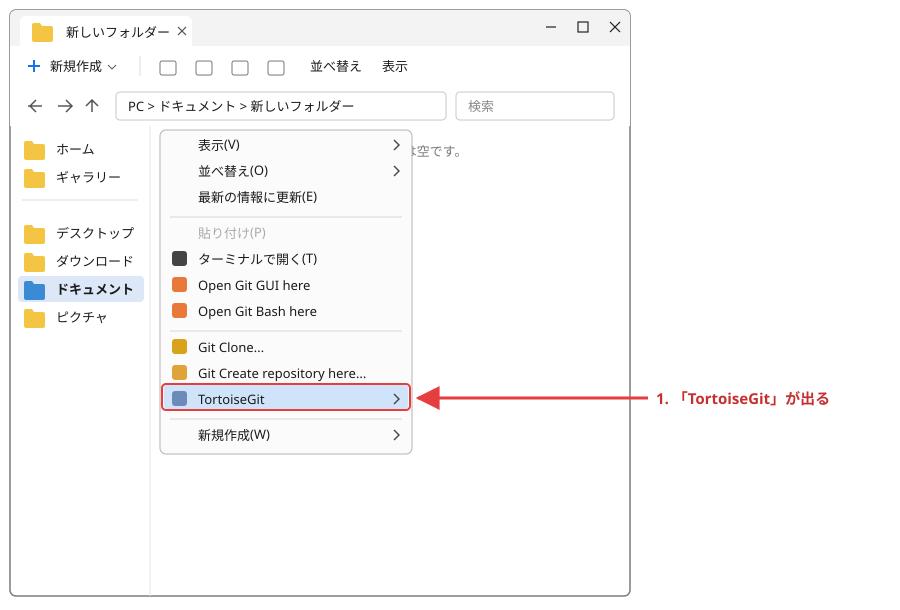

> [!TIP]
> **確認**
>
> - 右クリックのメニューに「TortoiseGit」が出た
> - 初回設定で、名前とメールアドレスが入っていた

### 5-3. TortoiseGit の日本語化

TortoiseGit は、そのままだと画面が英語だよ。日本語の言語パックを足して、表示を日本語にしよう。

#### ダウンロード

1. TortoiseGit のダウンロードページ(https://tortoisegit.org/download/)を開き、「Language Packs」の欄までスクロールする。

   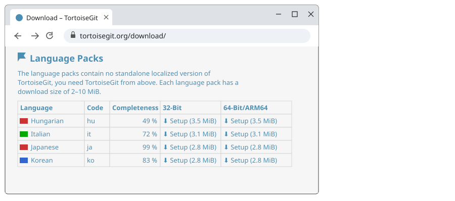

2. 自分のパソコンに合う版(64bit)の「Japanese」の行のリンクを押して、ダウンロードする。

   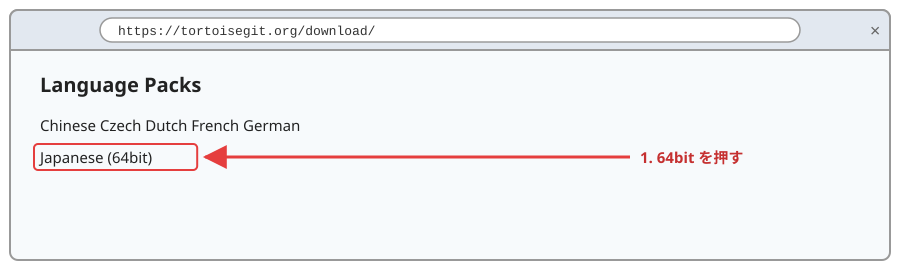

#### インストール

3. ダウンロードした言語パックをダブルクリックして起動する。

   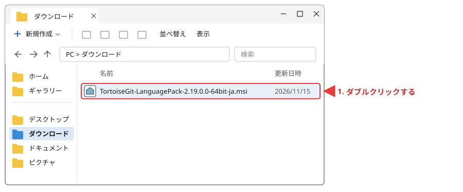

4. 最初の画面で「Next」を押す。

   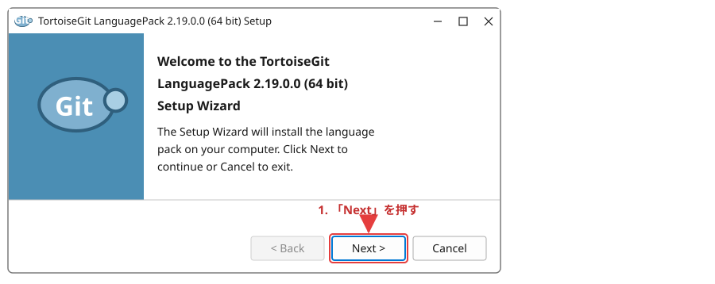

5. 「Install」を押す。

   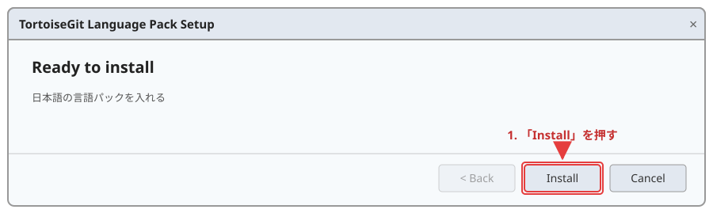

6. 完了画面で「Finish」を押す。

   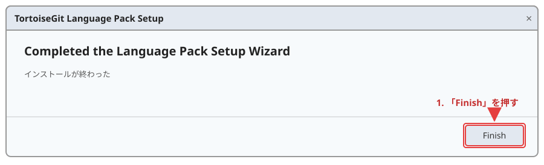

#### 設定

7. 適当なフォルダーの何もない場所で右クリックし、「TortoiseGit」→「Settings」を選ぶ。

   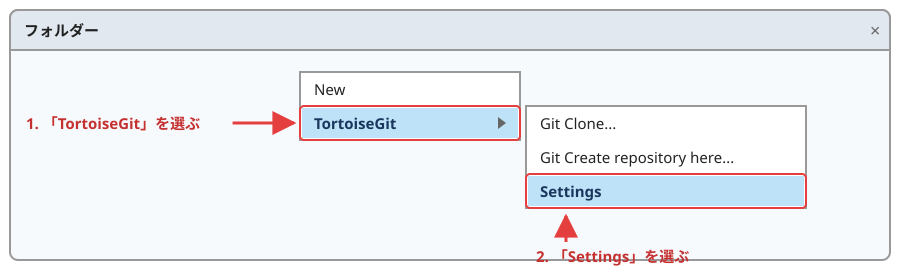

8. 左の一覧の「General」を選び、「Language」の欄を「日本語」に変えて「OK」を押す。

   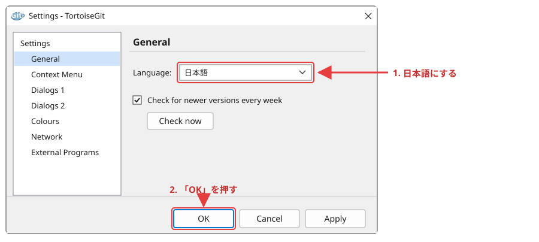

9. もう一度、フォルダーの何もない場所で右クリックし、メニューが日本語になっていることを確かめる。

   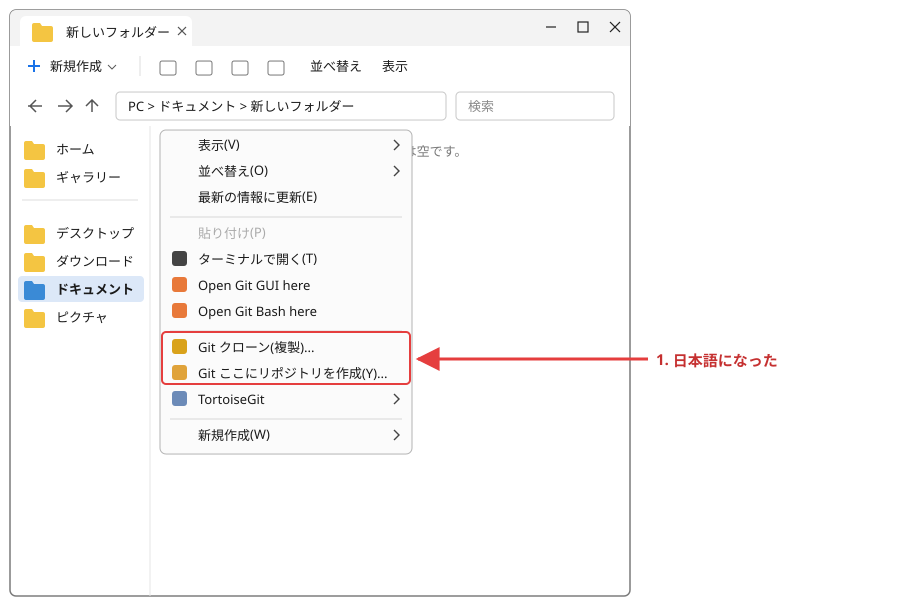

> [!TIP]
> **確認**
>
> - 右クリックのメニューが日本語で表示された

### 5-4. GitHub のアカウント

GitHub は、Git の記録を置いておく、インターネット上の共有の置き場所だよ。07章と08章で使う。
08章では、GitHub にサインインして、自分の変更を送る。そのために、アカウントを用意して、ユーザー名を確かめておこう。

すでに GitHub のアカウントを持っている人は、「アカウントを作る」を読み飛ばして、「ユーザー名を確認する」に進んでね。

#### アカウントを作る

1. ブラウザで GitHub のトップページ(https://github.com/)を開き、右上の「Sign up」を押す。

   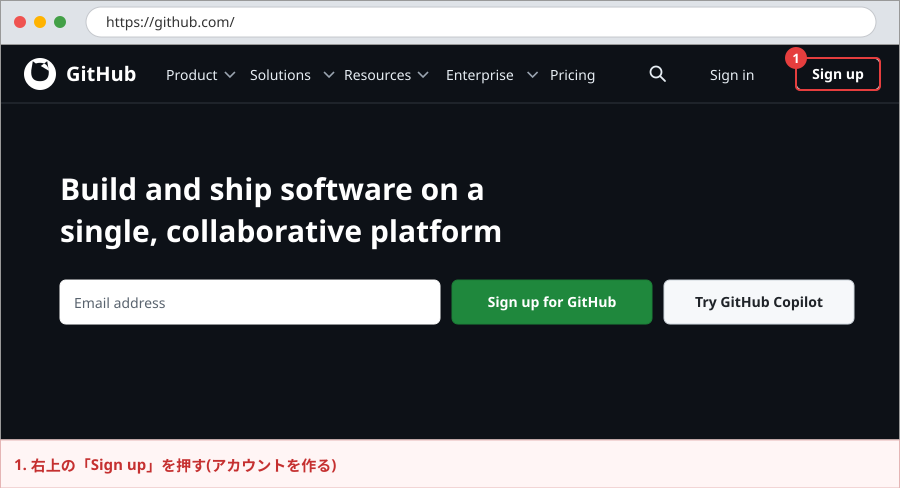

2. メールアドレス、パスワード、ユーザー名を入れて、「Continue」を押す。
   - ユーザー名は、自分で決める。あとで使うので、メモしておこう
   - 画面は、項目が1つずつ順番に出ることもある。案内に従って進めばいい

   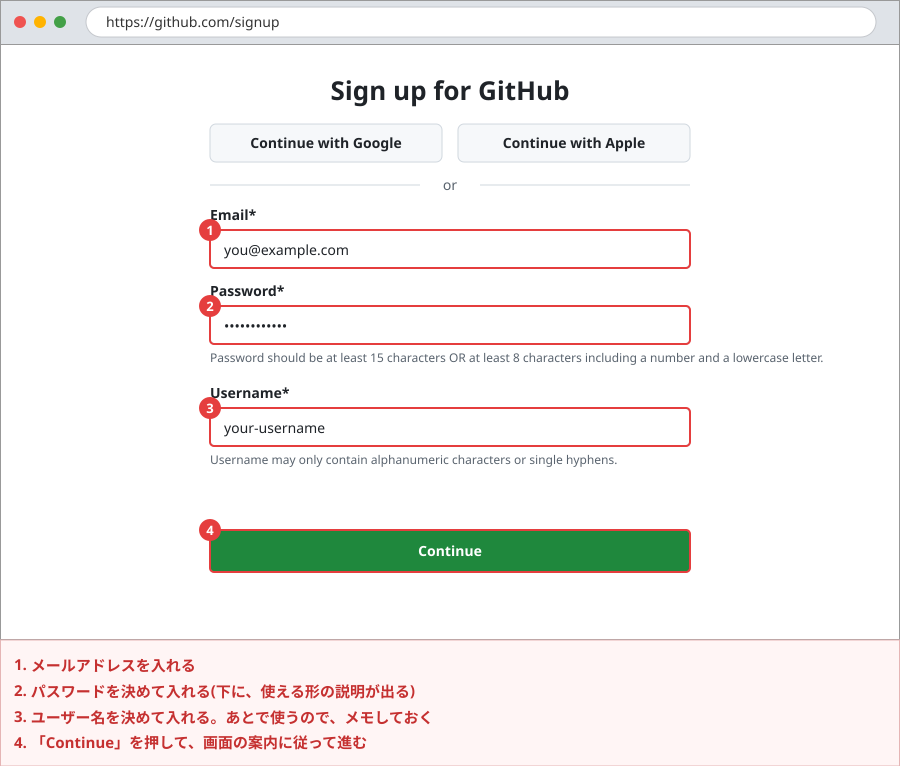

3. 登録したメールアドレスに、確認のコードが届く。メールを開いて、届いたコードを入れる。

   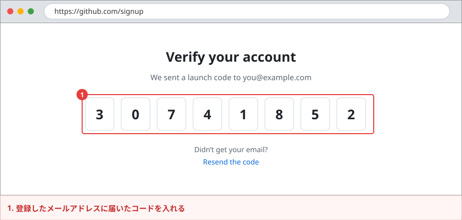

4. そのあとの案内の画面は、画面の指示に従って進める。アカウントができたら、サインインした状態になる。

#### ユーザー名を確認する

ユーザー名は、08章で GitHub にサインインするときに、聞かれることがある。メールアドレスとは別のものだよ。
自分のユーザー名を、次の方法で確かめて、メモしておこう。

5. GitHub にサインインした状態で、右上の丸いアイコンを押す。
6. 開いたメニューの「Signed in as」の下に出ている名前が、自分のユーザー名。

   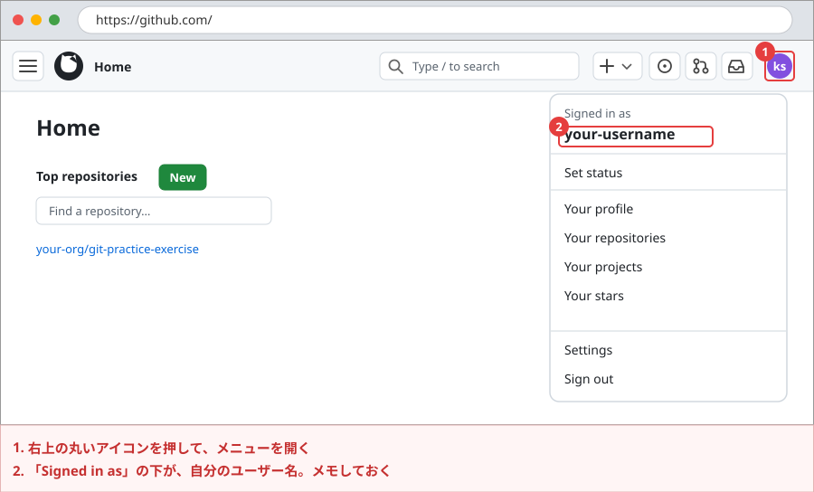

> [!TIP]
> **確認**
>
> - GitHub にサインインできた
> - 自分のユーザー名を確認して、メモした
