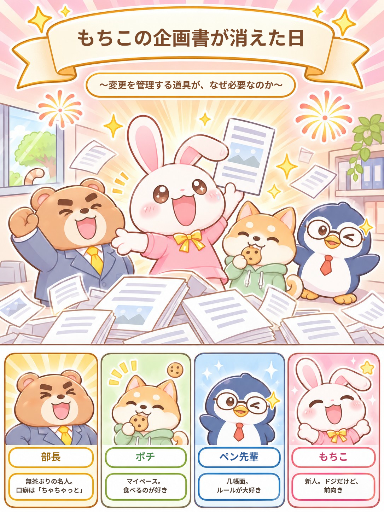
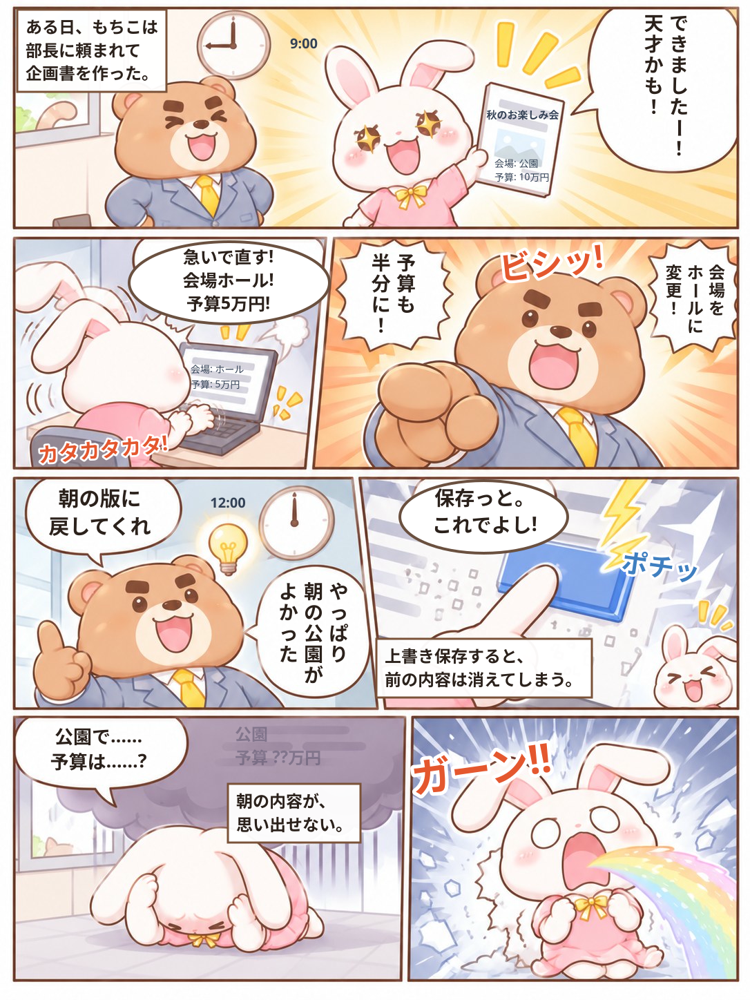
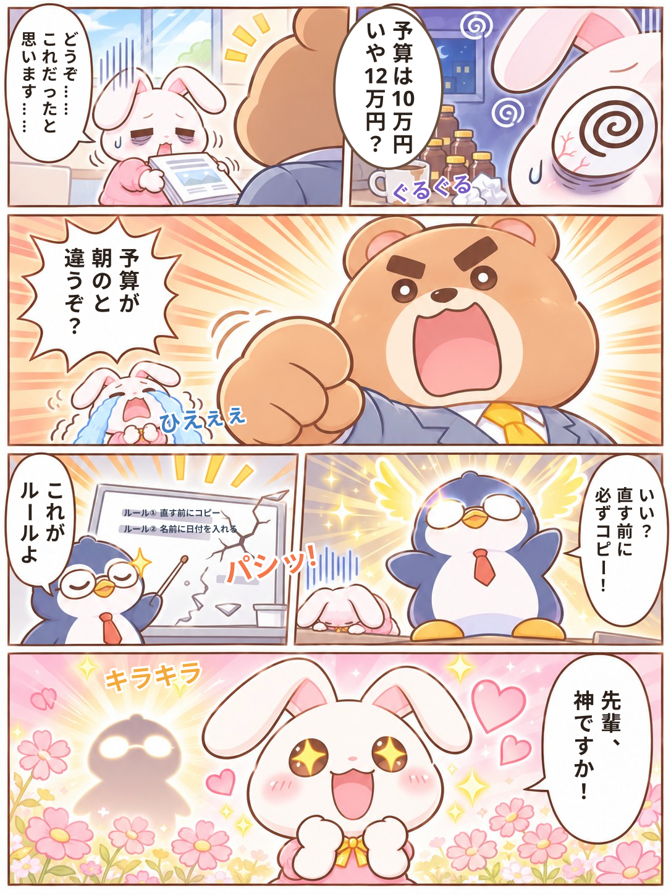
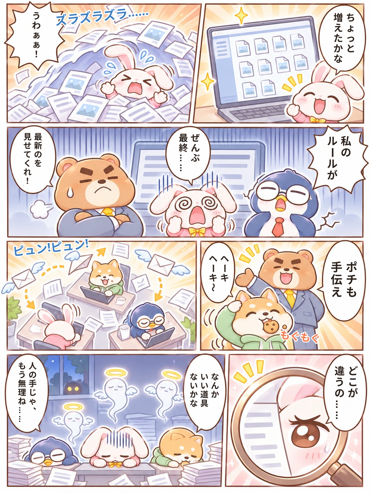
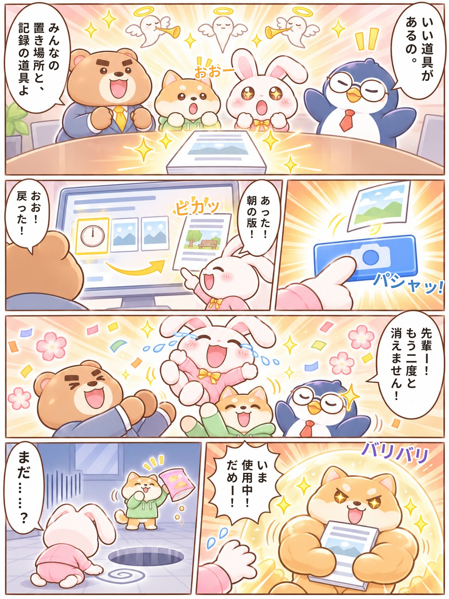
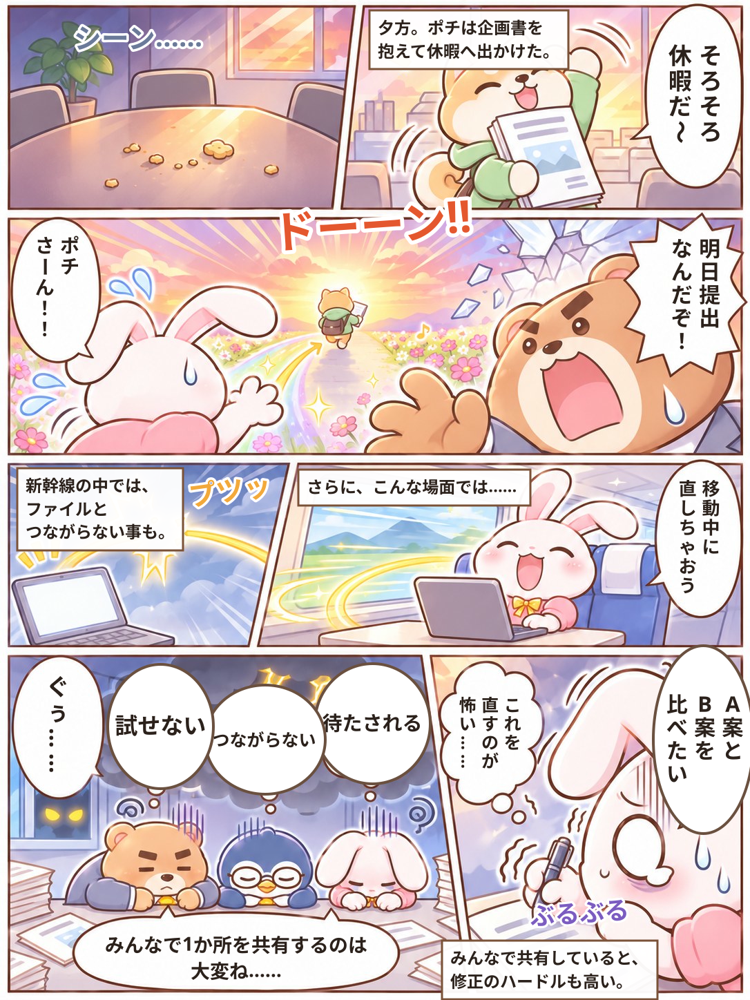
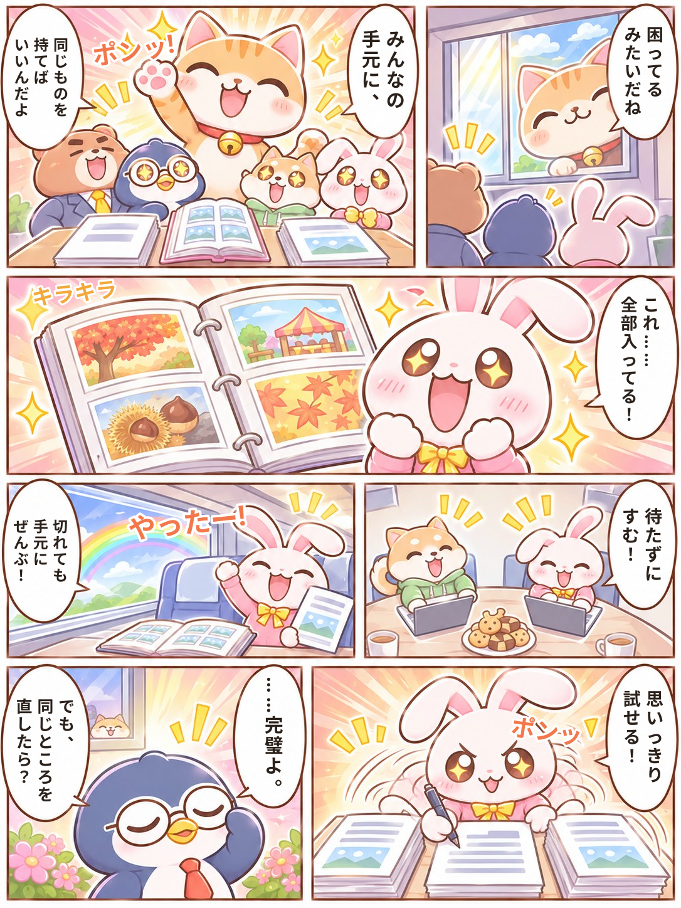
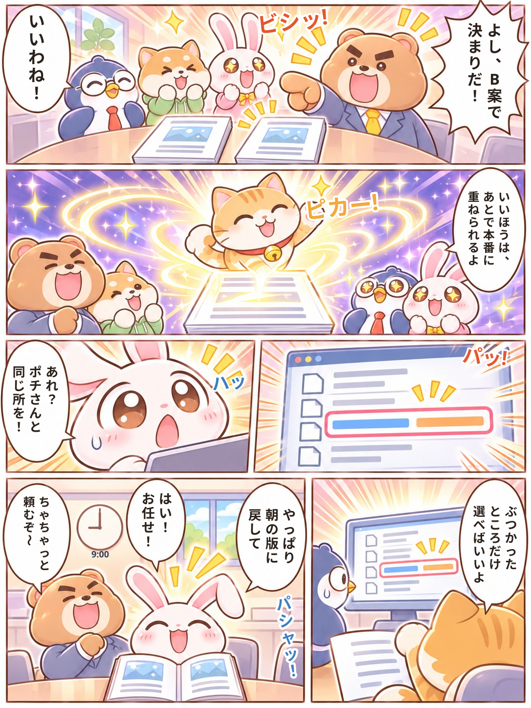
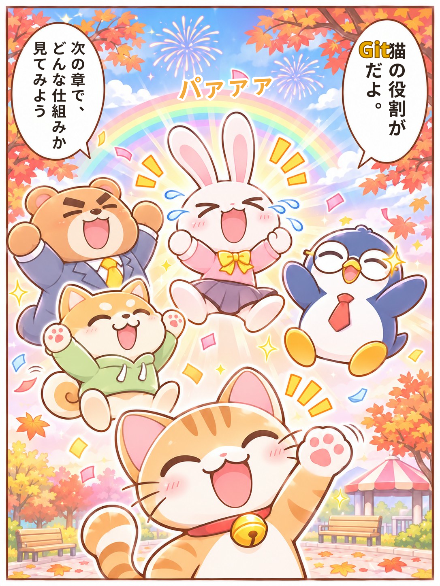

> [!TIP]
> 上書きすると、前の内容は消えてしまう。あとから「前のほうがよかった」となっても、戻せないんだ。

> [!TIP]
> 前の内容を残すために、直す前にコピーを取る。これが、人の手でする変更の管理だよ。

> [!TIP]
> コピーを増やす方法は、ファイルが増えるほど、どれが最新か分からなくなる。人が増えると、もっと混乱するんだ。

> [!TIP]
> みんなで同じ置き場所を使えば、最新のものが1つに決まる。でも、誰かが使っている間、ほかの人は待つしかない。

> [!TIP]
> 待たされる、つながらない、試せない。1か所をみんなで使う方法には、この3つの困りごとが残るんだ。

> [!TIP]
> 全員が、同じものを自分の手元に持てば、待たなくていい。つながらなくても作業できて、別の案も気軽に試せる。

> [!TIP]
> 同じところを2人が直しても、ぶつかったところだけ選べば解決する。

