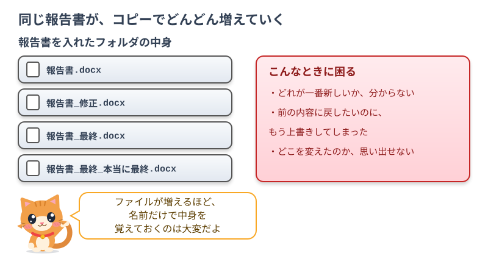
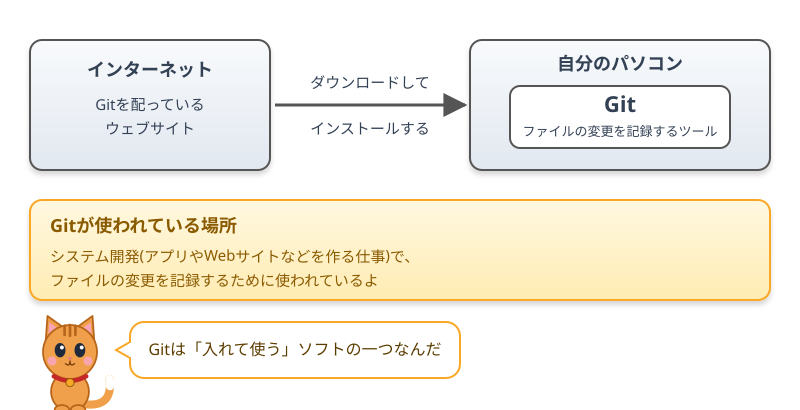
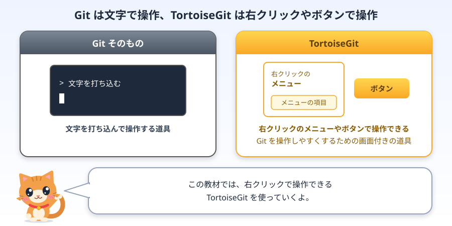
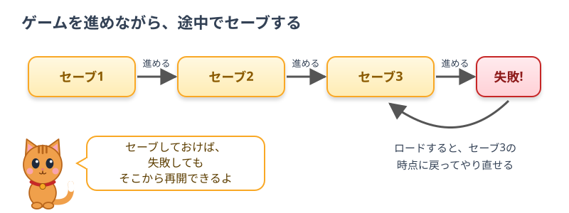
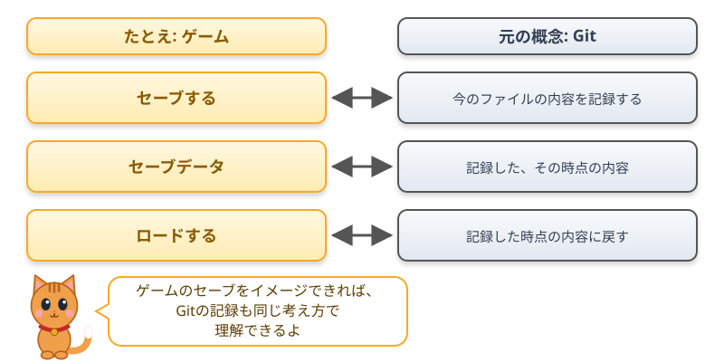

# 01 Gitの基本

この章では、Gitが何をするためのものかを、言葉と絵で理解する。
まだ操作はしない。「Gitは、ファイルの変更を記録して、前の状態に戻せるようにするツール」というイメージを持てればいい。

## 1. なぜGitが必要か

### ファイル管理とは

ファイル管理とは、作ったファイルに名前を付けて、フォルダに分けて、あとで見つけられるように保存しておくこと。
たとえば、報告書を Word(文書を作るソフト)で作って「報告書.docx」という名前でフォルダに保存する。これもファイル管理の一つだよ。

### ファイルは、何度も書き直される

ファイルは、作って終わりじゃない。報告書なら、内容を直したり、付け足したりして、何度も書き直す。
書き直す前の内容を残しておきたいとき、多くの人はファイルをコピーして、名前を変えて保存する。

この方法には、困りごとが出てくる。

- ファイルが増えて、どれが一番新しいのか分からなくなる
- 前の内容に戻したいのに、もう上書きしてしまっている
- どこを変えたのか、あとから思い出せない

原因は、「いつの時点の内容か」を、ファイルの名前だけで区別していること。
ファイルが増えるほど、名前だけで内容を覚えておくのは難しくなるんだ。

そこで、ファイルを何個もコピーせずに、変更の記録を残して、あとから前の内容に戻せる仕組みがほしくなる。
この役目をするのが Git だよ。

> [!TIP]
> **復習**
>
> - ファイル管理とは、ファイルに名前を付けて、フォルダに分けて、あとで見つけられるように（　　　）しておくことである
> - ファイルは作って終わりではなく、あとから何度も（　　　）ものである
> - ファイルをコピーして名前を変える方法では、どれが（　　　）か分からなくなる
> - Git は、ファイルの（　　　）を記録して、前の内容に戻せるようにするために必要になる
>
> 

> 
答えを見る

>
> 1. 保存
> 2. 書き直す
> 3. 最新（一番新しいもの）
> 4. 変更
>
> 

## 2. Gitとは何か

### Gitはパソコンで使うツール

Git は、パソコンの中で動くツール。ツールとは、仕事の道具になるソフトのことだよ。
Git の役目は、ファイルの変更を記録して、あとから前の内容に戻せるようにすること。前の節で見た困りごとを解決するための道具なんだ。

### 入手とインストール

Git は、最初からパソコンに入っているわけではない。
使えるようにするには、次の2つの作業が必要になる。

- ダウンロード: インターネットから、ファイルを自分のパソコンに保存すること
- インストール: ダウンロードしたソフトを、パソコンで使える状態にすること

Git は、インターネット上の配布サイトからダウンロードして、パソコンにインストールして使う。

> [!TIP]
> **復習**
>
> - Git は、パソコンの中で動く（　　　）である
> - Git は、インターネットから（　　　）して、パソコンに（　　　）して使う
>
> 

> 
答えを見る

>
> 1. ツール
> 2. ダウンロード、インストール
>
> 

### 操作には TortoiseGit を使う

Git そのものは、文字を打ち込んで操作する道具。
この教材では、右クリックのメニューやボタンで操作できる TortoiseGit を使う。TortoiseGit は、Git を操作しやすくするための画面付きの道具だよ。

TortoiseGit も、Git と同じように、パソコンにインストールして使う。
入れ方は、この教材の README.md(教材の案内が書いてあるファイル)にある「環境構築手順」の節を見てね。

### Gitが使われている場所

Git は、システム開発の現場で使われている。
システム開発とは、アプリや Web サイトなど、パソコンやスマートフォンで動くものを作る仕事のこと。

こうしたものは、作ったあとも何度も書き直す。書き直したあとで、前の内容に戻したくなることも多い。
だから、書き直しの記録を残せる Git が使われているんだ。

> [!TIP]
> **復習**
>
> - この教材では、右クリックで Git を操作できる（　　　）を使う
> - Git は、（　　　）の現場で使われている
>
> 

> 
答えを見る

>
> 1. TortoiseGit
> 2. システム開発
>
> 

## 3. Gitの考え方は、ゲームのセーブと同じ

### ゲームのセーブにたとえる

Git の考え方は、ゲームのセーブによく似ている。
ゲームを進めながら、途中でセーブしておく。失敗したら、ロードして、セーブした時点からやり直す。

セーブしておけば、失敗しても、最初からやり直さなくていい。セーブした時点まで戻れるからなんだ。

### たとえと Git の対応

ゲームでの言い方は、Git では次のことに当たる。

| ゲーム | Git |
|---|---|
| セーブする | 今のファイルの内容を記録する |
| セーブデータ | 記録した、その時点の内容 |
| ロードする | 記録した時点の内容に戻す |

Git を使うと、ファイルをコピーして名前を変えなくても、好きなタイミングで内容を記録できる。記録しておけば、あとからその時点の内容に戻れるんだ。
次の章では、実際にファイルの変更を記録していく。

> [!TIP]
> **復習**
>
> - ゲームでセーブしておくと、失敗しても、セーブした時点に（　　　）ことができる
> - Git で今のファイルの内容を残すことは、ゲームの（　　　）に当たる
> - Git で記録した時点の内容に戻すことは、ゲームの（　　　）に当たる
>
> 

> 
答えを見る

>
> 1. 戻る（やり直す）
> 2. セーブ
> 3. ロード
>
> 

---

次の章: [02 ファイルの変更管理](./02_ファイルの変更管理.md)
