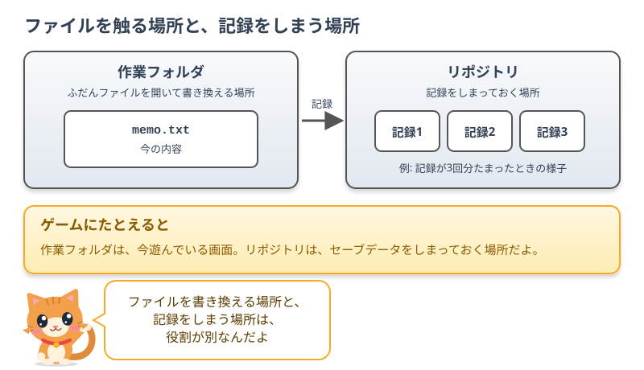
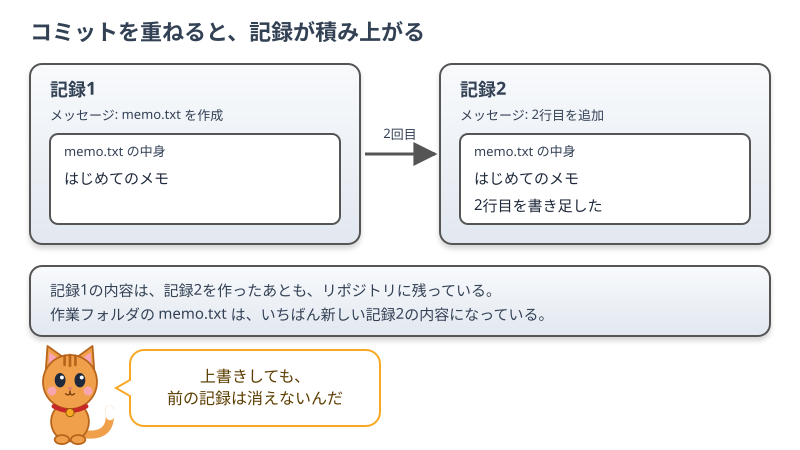
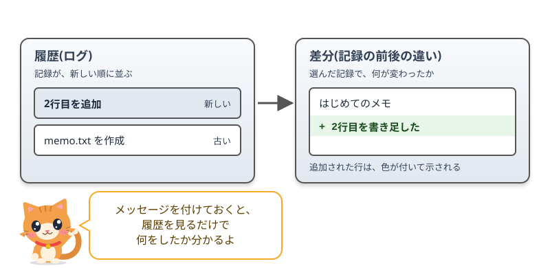

# 02 ファイルの変更管理

この章では、練習用のファイルを作って、変更を記録し、記録した履歴を見るところまで、実際に操作する。
手を動かしながら、「記録をしまう場所」「記録の残し方」「記録の見方」の3つを身につけよう。

操作には、01章で触れた TortoiseGit を使う。TortoiseGit は、右クリックのメニューから Git を操作できる道具だよ。
メニューの名前は、TortoiseGit のバージョンや言語の設定によって、少し違うことがある。
また、Windows 11 では、右クリックしたあとに「その他のオプションを確認」を押すと、メニューが出る場合がある。

## 1. 記録をしまう場所: リポジトリ

### 記録は、どこにしまうのか

01章では、Git を使うと、ファイルの内容を好きなタイミングで記録できると学んだ。
記録を残すなら、記録をしまっておく場所が必要になる。ゲームでいえば、セーブデータをしまっておく場所だよ。

この場所を、リポジトリと呼ぶ。リポジトリは、ファイルの記録をしまっておく場所のこと。
しまった記録を新しい順に並べたものは、履歴（ログ）と呼ぶよ。

### 作業フォルダとリポジトリ

ファイルを開いて書き換えるフォルダは、作業フォルダと呼ぶ。ふだん自分がファイルを触っている、いつものフォルダのことだよ。
ファイルを書き換える場所（作業フォルダ）と、記録をしまう場所（リポジトリ）は、役割が違う。

ゲームのたとえとの対応は、次のとおり。

| ゲーム | Git |
|---|---|
| 今遊んでいる画面 | 作業フォルダ（ファイルを書き換える場所） |
| セーブデータをしまっておく場所 | リポジトリ（記録をしまっておく場所） |

リポジトリの実体は、作業フォルダの中の `.git` という隠しフォルダだよ。隠しフォルダとは、Windows がふだんは画面に表示しないフォルダのこと。中を触る必要はない。

> [!TIP]
> **復習**
>
> - 記録をしまっておく場所を（　　　）と呼ぶ
> - ふだんファイルを開いて書き換えるフォルダを（　　　）と呼ぶ
> - リポジトリの実体は、作業フォルダの中の `.git` という（　　　）フォルダである
> - 記録を新しい順に並べたものを（　　　）と呼ぶ
>
> 

> 
答えを見る

>
> 1. リポジトリ
> 2. 作業フォルダ
> 3. 隠し
> 4. 履歴（ログ）
>
> 

## 2. リポジトリを作る

### 練習用のフォルダを用意する

まず、練習用のフォルダを作る。

1. 好きな場所に、`sample-project` という名前のフォルダを作る
2. このフォルダを、これから06章まで練習で使う作業フォルダにする。保存した場所を覚えておこう

### リポジトリを作る

作った `sample-project` フォルダの中に、リポジトリを作る。

1. `sample-project` フォルダの中の、何もない場所で右クリックする
2. メニューから `Git Create repository here...`（ここにリポジトリを作成）を選ぶ
3. 表示された画面は、設定を変えずに `OK` を押す

これで、`sample-project` が、リポジトリを持つ作業フォルダになった。
まだファイルは何も記録していないので、リポジトリの中は空の状態だよ。

> [!TIP]
> **復習**
>
> - 練習では、ファイルを書き換えるフォルダ `sample-project` を、（　　　）として使う
> - リポジトリは、右クリックのメニューの（　　　）で作る
> - リポジトリを作った直後は、記録は（　　　）である
>
> 

> 
答えを見る

>
> 1. 作業フォルダ（フォルダ）
> 2. `Git Create repository here...`（ここにリポジトリを作成）
> 3. 空（何もない）
>
> 

## 3. 最初の記録を残す: コミット

### コミットとメッセージ

ファイルの今の内容を、1回分の記録としてリポジトリに残すことを、コミットと呼ぶ。ゲームでいえば、セーブすることだよ。
残った1回分の記録そのものも、コミットと呼ぶ。「コミットする」は記録を残す操作、「1つのコミット」は残った1回分の記録のことだよ。
コミットするときは、「何を変えたか」を短く書く。これを、コミットメッセージと呼ぶ。セーブデータに付けるタイトルのようなものだよ。

| ゲーム | Git |
|---|---|
| セーブする | コミットする（1回分の記録を残す） |
| セーブデータのタイトル | コミットメッセージ（何を変えたかのメモ） |

メッセージを書いておくと、あとから履歴を見たときに、何を記録したのかが分かる。

### ファイルを作って、コミットする

記録するファイルを作ってから、コミットしよう。

1. `sample-project` フォルダの中で右クリックして、「新規作成」から「テキスト ドキュメント」を選ぶ
2. 名前を `memo.txt` にする
3. `memo.txt` をダブルクリックして開き、「はじめてのメモ」と書いて保存する
4. `sample-project` フォルダの中の、何もない場所で右クリックして、`Git Commit...`（記録する）を選ぶ

名前の最後の `.txt` は、ファイルの種類を表す部分で、拡張子と呼ぶ。ふだん見えていないときは、エクスプローラーの上部にある「表示」から「ファイル名拡張子」にチェックを入れると、見えるようになる。`memo.txt.txt` のように二重になっていないか確認しよう。

4で、コミットの画面が開く。

画面では、次のことをする。

1. メッセージ欄に、「memo.txt を作成」と書く
2. 記録するファイルの一覧で、`memo.txt` にチェックが入っているか確認する
3. `Commit` ボタンを押す

初めてコミットするときは、名前とメールアドレスを入力する画面が出る場合がある。そのときは、自分の名前とメールアドレスを入れよう。
一覧に `memo.txt` が出ないときは、保存できているか、`sample-project` フォルダの中で右クリックしたかを確認しよう。

コミットが終わると、結果の画面が出る。内容を確認して閉じよう。
一覧にチェックを入れるのは、「どのファイルを記録するか」を選ぶため。記録したくないファイルがあれば、チェックを外して記録から除ける。今は、記録したいファイルにチェックが入っていれば十分だよ。

> [!TIP]
> **復習**
>
> - ファイルの今の内容を、1回分の記録として残すことを（　　　）と呼ぶ
> - 「何を変えたか」を短く書いたメモを、（　　　）と呼ぶ
> - コミットの画面では、記録したいファイルに（　　　）を入れて、Commit ボタンを押す
>
> 

> 
答えを見る

>
> 1. コミット
> 2. コミットメッセージ
> 3. チェック
>
> 

## 4. 変更して、もう一度コミットする

### ファイルを書き換える

もう一度、変更を記録してみよう。

1. `memo.txt` を開いて、2行目に「2行目を書き足した」と書き足し、保存する
2. `sample-project` フォルダの中の、何もない場所で右クリックして、`Git Commit...`（記録する）を選ぶ
3. メッセージ欄に、「2行目を追加」と書く
4. `memo.txt` にチェックが入っているか確認して、`Commit` ボタンを押す

これで、リポジトリに2回分の記録が残った。

### 前の記録は、消えない

2回目のコミットをしても、1回目の記録は消えない。
作業フォルダの `memo.txt` は、いちばん新しい内容に書き換わっている。でも、「はじめてのメモ」だけだった時点の内容も、リポジトリに残っているんだ。

01章で、ファイルをコピーして名前を変えなくても、前の内容を残せると学んだね。それが、このことだよ。

> [!TIP]
> **復習**
>
> - 2回目のコミットをしても、「はじめてのメモ」だけだった時点の内容は（　　　）
> - 作業フォルダの `memo.txt` は、いちばん（　　　）内容になっている
> - コミットを重ねると、リポジトリには1回分の記録が、1回ずつ（　　　）
>
> 

> 
答えを見る

>
> 1. 消えずに、リポジトリに残っている
> 2. 新しい
> 3. 増えていく
>
> 

## 5. 履歴と差分を見る

### 履歴を見る

リポジトリに残した記録を新しい順に並べたものが、履歴（ログ）だったね。履歴を見ると、いつ、何を記録したかが分かる。

1. `sample-project` フォルダの中の、何もない場所で右クリックする
2. `TortoiseGit` の中から、`Show log`（ログを表示）を選ぶ

画面の上側に、記録の一覧が出る。「2行目を追加」と「memo.txt を作成」の2つが、新しい順に並んでいるはずだよ。
書いたコミットメッセージが並ぶので、メッセージを見るだけで、何をしたか分かる。

### 差分を見る

2つの時点の内容の違いを、差分と呼ぶ。差分を見ると、「その記録で、何が変わったか」がはっきり分かる。

1. 履歴の一覧で、「2行目を追加」の記録を選ぶ
2. 画面の下側に、その記録で変更されたファイルの一覧が出る
3. 一覧の `memo.txt` をダブルクリックする

比較の画面が開いて、追加した「2行目を書き足した」の行が、色（緑色など）を付けて示される。

> [!TIP]
> **復習**
>
> - 履歴を見るときは、右クリックのメニューの `TortoiseGit` から（　　　）を選ぶ
> - 2つの時点の内容の違いを（　　　）と呼ぶ
> - 履歴の一覧では、書いた（　　　）を見ると、何を記録したのかが分かる
>
> 

> 
答えを見る

>
> 1. `Show log`（ログを表示）
> 2. 差分
> 3. コミットメッセージ（メッセージ）
>
> 

この章で作った `sample-project` は、06章まで使う。消さずに残しておこう。

間違えて変更してしまったときに、前の状態へ戻す方法は、次の03章で学ぶよ。

---

次の章: [03 変更の取り消し](./03_変更の取り消し.md)
