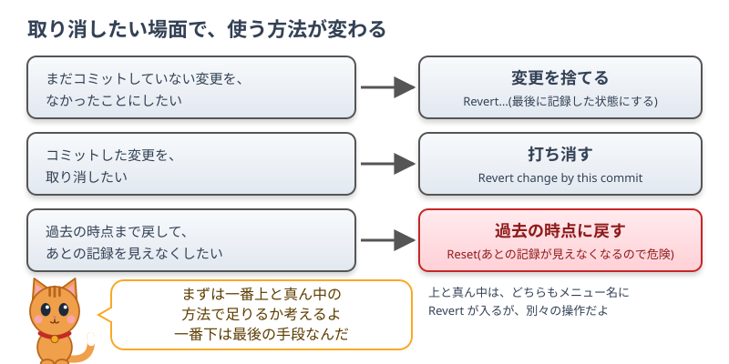
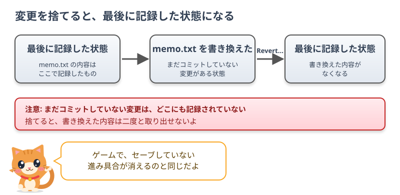
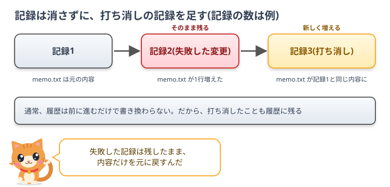
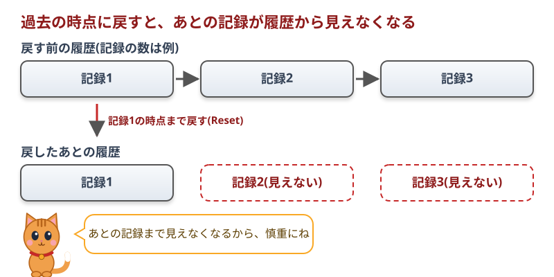

# 03 変更の取り消し

この章では、間違えた変更を取り消す方法を学ぶ。
取り消し方は3つあって、場面によって使い分ける。まずは「どの場面でどれを使うか」をつかめればいい。

02章で作った `sample-project` フォルダの `memo.txt` を使って、実際に操作もしてみるよ。

## 1. 取り消し方は3つある

### 3つの場面

02章では、ファイルの今の内容を1回分の記録として残すこと(コミット)を学んだ。
履歴は、その記録を新しい順に並べたものだったね。
間違えたときに何をしたいかは、コミットしたかどうかで変わる。

- まだコミットしていない変更を、なかったことにしたい
- コミットした変更を、取り消したい
- 過去の時点まで戻して、あとの記録を履歴から見えなくしたい

それぞれに対応する方法がある。この章では、上から順に1つずつ見ていく。
3つ目の方法は影響が大きいので、最後の手段として考えてほしい。

### 呼び名を分けておく

この章では、メニュー名を英語の表記で書いて、日本語の意味を括弧で添える。
TortoiseGit のバージョンや言語設定で、メニューの表記が少し違うことがある。

1つ目と2つ目の方法は、どちらもメニュー名に「Revert」が入る。Revert は、英語で「元に戻す」という意味だよ。
でも、この2つは別々の操作なんだ。混ざらないように、この章では次のように呼び分ける。

| この章での呼び名 | メニュー名 | 使う場面 |
|---|---|---|
| 変更を捨てる | Revert... | まだコミットしていない変更 |
| 打ち消す | Revert change by this commit | コミットした変更 |
| 過去の時点に戻す | Reset | 過去の時点まで戻したいとき |

3つ目の Reset は、4節で説明するよ。

01章のゲームのセーブとロードは、Git では、取り消したい範囲によって3つの方法に分かれるんだ。
それぞれで、履歴は次のようになる。

| 方法 | 履歴はどうなるか |
|---|---|
| 変更を捨てる | まだ記録されていないので、履歴は変わらない |
| 打ち消す | 元の記録は残り、打ち消しの記録が増える |
| 過去の時点に戻す | 選んだ記録より後の記録が、履歴から見えなくなる |

> [!TIP]
> **復習**
>
> - まだコミットしていない変更をなかったことにしたいときは、変更を（　　　）方法を使う
> - コミットした変更を取り消したいときは、（　　　）方法を使う
> - 過去の時点に戻す方法は、あとの記録が履歴から見えなくなるので（　　　）である
>
> 

> 
答えを見る

>
> 1. 捨てる(Revert...)
> 2. 打ち消す(Revert change by this commit)
> 3. 危険
>
> 

## 2. コミット前の変更を捨てる

### 変更を捨てると、どうなるか

`memo.txt` を書き換えたあと、この変更はいらなかった、と気づくことがある。
まだコミットしていないなら、変更を捨てる方法が使える。メニュー名は Revert...(変更を捨てる)だよ。
変更を捨てると、`memo.txt` は最後にコミットした状態になる。

### ゲームのセーブでたとえると

01章のゲームのセーブを思い出してほしい。
最後にセーブしたあとに進めた分をなかったことにしたいとき、ロードして、最後のセーブの状態にする。変更を捨てるのは、これと同じ考え方だよ。

| ゲーム | Git |
|---|---|
| 最後のセーブ | 最後にコミットした状態 |
| セーブしていない進み具合 | まだコミットしていない変更 |
| ロードして、最後のセーブの状態にする | 変更を捨てて、最後にコミットした状態にする |

### 注意: 捨てた変更は取り出せない

セーブしていない進み具合は、ロードすると消える。
同じように、まだコミットしていない変更は、Git の記録に入っていない。だから、変更を捨てると、その変更は二度と取り出せないよ。
「もう使わない」と決めてから、実行しよう。

### やってみよう: 変更を捨てる

1. `sample-project` フォルダの `memo.txt` を開く
2. 1行付け足して、保存する。内容は何でもいい。たとえば「元に戻す練習」と書く
3. `memo.txt` を右クリックして、右クリックメニューの「TortoiseGit」の中にある「Revert...」(変更を捨てる)を選ぶ
4. 表示された画面で、`memo.txt` にチェックが付いていることを確認して、「OK」を押す
5. もう一度 `memo.txt` を開く。付け足した1行がなくなっていれば成功

> [!TIP]
> **復習**
>
> - まだコミットしていない変更を捨てて、最後にコミットした状態にする操作のメニュー名は（　　　）である
> - 変更を捨てるのは、ゲームで最後のセーブの状態にする（　　　）に似ている
> - まだコミットしていない変更は、捨てると（　　　）取り出せない
>
> 

> 
答えを見る

>
> 1. Revert...
> 2. ロード
> 3. 二度と
>
> 

## 3. コミット済みの変更を打ち消す

### 記録は残して、打ち消しを記録する

コミットした変更を取り消したいときは、別の方法を使う。
その記録はそのまま残して、「その変更を打ち消す内容」を、新しい記録として履歴に追加するんだ。

通常、履歴に残っている記録は、あとから書き換えない。
書き換えないので、「失敗した」ことも「打ち消した」ことも、履歴にそのまま残る。あとで見返したときに、何があったのかが分かるよ。
書き換える例外の操作は、4節で出てくる過去の時点に戻す方法だけだよ。

### ゲームのセーブでたとえると

ゲームのロードでは、ロードしたあとの進み具合は消える。
打ち消しは少し違う。失敗したセーブはそのまま残して、失敗を取り消した状態を、新しいセーブとして保存するイメージだよ。

| ゲーム | Git |
|---|---|
| 失敗したあとのセーブ | 取り消したい変更が入ったコミット |
| 失敗を取り消した状態を、新しくセーブする | 打ち消しの内容を、新しいコミットとして記録する |

### やってみよう: コミットした変更を打ち消す

1. `memo.txt` に1行付け足して、保存する
2. 02章と同じ手順で、「Git Commit...」(記録する)を使ってコミットする。コミットメッセージは「失敗した変更」にする
3. `sample-project` フォルダの空いている場所を右クリックして、右クリックメニューの「TortoiseGit」の中にある「Show log」(ログを表示)を選ぶ
4. 一番上の「失敗した変更」の記録を右クリックして、「Revert change by this commit」(この記録の変更を打ち消す)を選ぶ
5. 画面が出た場合は、書かれている指示に従って進める
6. `memo.txt` の内容が、付け足す前の状態になっていることを確認する
7. コミットの画面が開いていて、メッセージが入っている場合は、そのまま記録する
8. コミットの画面が開いていない場合は、02章と同じ手順でコミットする。コミットメッセージは「失敗した変更を取り消す」にする
9. ログを見て、「失敗した変更」の記録が残ったまま、一番上に打ち消しの記録が増えていることを確認する

> [!TIP]
> **復習**
>
> - コミットした変更を取り消すときは、元の記録を残したまま、（　　　）の記録を新しく足す
> - 打ち消しをしても、失敗した記録は履歴に（　　　）
> - 打ち消しは、ゲームでは「失敗を取り消した状態を、（　　　）として保存する」イメージである
>
> 

> 
答えを見る

>
> 1. 打ち消し
> 2. 残る
> 3. 新しいセーブ
>
> 

## 4. 過去の時点に戻す

### あとの記録を履歴から見えなくする方法もある

もう1つ、過去の時点まで戻す方法がある。この操作は Reset(リセット)と呼ぶ。
ログの画面で戻したい記録を選び、その時点まで戻す。

Reset をすると、選んだ記録より後の記録は、履歴から見えなくなる。
ゲームでいえば、古いセーブを選んで、それより新しいセーブデータが使えなくなるようなものだよ。

| ゲーム | Git |
|---|---|
| 古いセーブを選ぶ | 戻したい記録を選ぶ |
| それより新しいセーブデータが使えなくなる | それより後の記録が、履歴から見えなくなる |

### まず、前の2つで足りないか考える

Reset は、通常は書き換えない履歴を変えてしまう、例外の操作なんだ。
あとの記録が履歴から見えなくなると、あとから取り出せなくなることがある。だから危険だよ。
取り消したいだけなら、前の2つで足りることが多い。

- まだコミットしていない変更 → 変更を捨てる(Revert...)
- コミットした変更 → 打ち消す(Revert change by this commit)

危険な操作なので、この章では Reset のやり方までは扱わない。「こういう操作がある。むやみに使わない」と覚えておけば十分だよ。

> [!TIP]
> **復習**
>
> - 過去の時点まで戻して、あとの記録を履歴から見えなくする操作を（　　　）と呼ぶ
> - Reset をすると、選んだ記録より（　　　）の記録は、履歴から見えなくなる
> - 取り消したいだけのときは、まず変更を捨てるか、（　　　）で足りないかを考える
>
> 

> 
答えを見る

>
> 1. Reset
> 2. 後
> 3. 打ち消す
>
> 

## 次の章へ

ここまでで、間違えた変更を取り消す方法が分かった。
次の04章では、作業を分けて進める方法を学ぶよ。

---

次の章: [04 ブランチによる作業の分割](./04_ブランチによる作業の分割.md)
