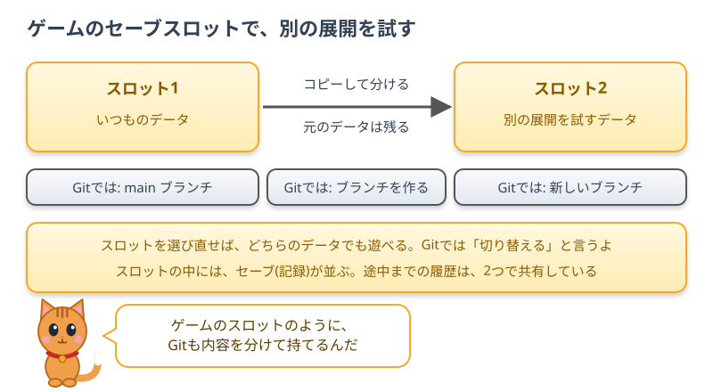

# 04 ブランチによる作業の分割

この章では、ブランチを使って作業を分ける方法を学ぶ。
ブランチは、記録の流れを枝分かれさせて、作業を別々に進められるようにするしくみだよ。
03章では、記録した変更を取り消す方法を学んだ。取り消しもできるけれど、大きな変更は、いまの内容とは別の場所で試すほうが安全なんだ。
最後に、ブランチを作って切り替えて、memo.txt の中身が変わるところを自分の目で確かめる。

## 1. なぜ作業を分けたいのか

### 試したいけど、いまの内容は残したい

ここまでで、memo.txt の変更をコミット（ファイルの内容を記録する操作）で残せるようになった。
では、memo.txt に大きな変更を試してみたいときは、どうだろう。うまくいくかは、やってみないと分からない。でも、いまの内容はちゃんと残しておきたい。

同じ場所で試すと、次のことが困りごとになる。

- 書きかけの内容が、いまの内容と混ざってしまう
- 失敗したときに、試す前の状態へ戻す手間がかかる

そこで、「いまの内容」と「試す内容」を、別々の場所に分けて進めたくなる。それを実現するしくみが、ブランチだよ。

> [!TIP]
> **復習**
>
> - 大きな変更を試すときは、いまの内容を（　　　）したい
> - 同じ場所で試すと、書きかけの内容が、いまの内容と（　　　）しまう
> - そこで、いまの内容と試す内容を（　　　）進めたくなる
>
> 

> 
答えを見る

>
> 1. 残しておき（残し）
> 2. 混ざって
> 3. 別々に（別の場所に分けて）
>
> 

## 2. ブランチとは

### 記録の流れを枝分かれさせるしくみ

ブランチ（branch）は、英語で「枝」という意味。
コミットを積み重ねてきた記録の流れ（履歴）を、途中から枝分かれさせて、別々に記録を積めるようにするしくみだよ。

これまで記録を積んできた流れも、実はブランチの1本で、「main」という名前が付いている。ブランチは、最初から1本あったんだ。

イメージしやすいように、ゲームのセーブスロットにたとえてみる。
スロット1のデータをコピーして、スロット2に分ける。スロット1はそのまま残るから、スロット2では、安心して別の展開を試せるよね。

たとえと Git の対応は、次のとおり。

| ゲーム | Git |
|---|---|
| スロット1（いつものデータ） | main ブランチ |
| コピーして分ける | ブランチを作る |
| スロット2（別の展開を試すデータ） | 新しいブランチ |
| スロットを選び直す | ブランチを切り替える |

スロットの中には、セーブ（記録）が並んでいる。たとえでは「コピー」と言ったけれど、ブランチを作っても、中身を全部コピーするわけではない。分かれる前までの履歴は、2つのブランチで共有しているんだ。

### 枝分かれしても、元の流れは変わらない

ブランチを作ると、記録の流れが途中から2本に分かれる。
新しい記録は、いま切り替えているブランチのほうにだけ積まれる。もう一方のブランチの記録は、そのまま変わらない。

図の add-line は、このあとの練習で作るブランチの名前（例）だよ。図の記録の数も例で、自分の履歴とは違っていていい。

これなら、試した内容がうまくいかなくても、元の流れには影響がない。

> [!TIP]
> **復習**
>
> - ブランチは、記録の流れを（　　　）させるしくみである
> - ブランチを作ると、新しい記録は、いま切り替えている（　　　）にだけ積まれる
> - ゲームにたとえると、ブランチを作ることは、データを（　　　）して別のスロットに分けることに当たる
>
> 

> 
答えを見る

>
> 1. 枝分かれ
> 2. ブランチ
> 3. コピー
>
> 

### main と、切り替え

これまで記録を積んできた流れは、「main」という名前のブランチだよ。
いま切り替えているブランチの名前は、ログ画面で確かめられる。右クリックから TortoiseGit → Show log（ログを表示）を選ぶと、一番上の記録に、ブランチ名のラベルが付いている。

環境によっては、ラベルが「master」になっている。その場合は、この教材の「main」を「master」に読み替えてね。05章と06章でも、同じ読み替えで進める。

memo.txt などを置いて作業しているフォルダ（作業フォルダ）の中身は、いつも、いま切り替えているブランチの内容になっている。
別のブランチに移ることを、切り替えると言う。切り替えると、作業フォルダの中身が、そのブランチの内容に入れ替わる。

追加した行は、消えたわけじゃない。add-line ブランチの記録の中に残っていて、add-line に切り替えれば、また現れる。

> [!TIP]
> **復習**
>
> - これまで記録を積んできた流れは、（　　　）という名前のブランチである
> - 別のブランチに移ることを（　　　）と言う
> - 切り替えると、作業フォルダの中の（　　　）が、そのブランチの内容に入れ替わる
>
> 

> 
答えを見る

>
> 1. main
> 2. 切り替える
> 3. ファイルの中身（memo.txt の中身）
>
> 

## 3. 手を動かす: ブランチを作って切り替える

ここからは、sample-project フォルダの memo.txt を使って、実際にブランチを作る。
memo.txt は、これまでの章で作って、コミットまで済んでいるものとする。

操作は、右クリックのメニューから行う。メニューの名前は、TortoiseGit のバージョンや言語設定で、少し違うことがある。

### 手順1: ブランチを作る

1. sample-project フォルダの中の、何もない場所で右クリックする
2. TortoiseGit → Create Branch...（ブランチを作成）を選ぶ
3. Branch の欄に `add-line` と入力する
4. Switch to new branch（作ったブランチに、そのまま切り替える）にチェックを入れる
5. OK を押す

ブランチは作っただけだと、いま切り替えているブランチは main のまま。切り替えまでしておくと、ここから add-line の上で作業できる。

### 手順2: memo.txt を編集してコミットする

1. memo.txt を開いて、最後に1行追加する。内容は何でもいい。たとえば「ブランチで追加した行」
2. 保存して、閉じる
3. sample-project フォルダの中で右クリックして、Git Commit...（記録する）を選ぶ
4. コミットメッセージに「memo.txtに1行追加」と入力して、Commit を押す

メニューには、いま切り替えているブランチの名前が付いて、Git Commit -> "add-line"... のように表示されることがある。同じ「記録する」操作だよ。

この章の練習で add-line に積む記録は、この1つだけ。この記録は、add-line ブランチにだけ積まれる。main には積まれない。

### 手順3: ログで枝の位置を確かめる

1. sample-project フォルダの中で右クリックして、TortoiseGit → Show log（ログを表示）を選ぶ
2. 記録の一覧を見る

一番上の記録に、add-line というブランチ名のラベルが付いている。その1つ前の記録には、main のラベルが付いている。
これは、main の記録より、add-line の記録が1つ先に進んでいる状態だよ。

> [!TIP]
> **復習**
>
> - ブランチを作るときは、右クリックから TortoiseGit → （　　　）を選ぶ
> - add-line で記録した内容は、（　　　）には積まれない
> - Show log で見ると、add-line のラベルは、main のラベルが付いた記録より（　　　）にある
>
> 

> 
答えを見る

>
> 1. Create Branch...（ブランチを作成）
> 2. main
> 3. 1つ先（新しい記録のほう）
>
> 

### 手順4: main に切り替えて確かめる

切り替える前に、変更したままコミットしていないファイルがないか確かめる。変更が途中だと、切り替えがうまくいかないことがあるんだ。そのときは、先にコミットする。変更を捨てたいときは、03章の方法で元に戻す。

1. sample-project フォルダの中で右クリックして、TortoiseGit → Switch/Checkout...（ブランチを切り替え）を選ぶ
2. Branch で main を選んで、OK を押す（ラベルが master だった人は、master を選ぶ）
3. memo.txt を開く

手順2で追加した行が、なくなっているはず。
消えたわけではなく、作業フォルダが main の内容に入れ替わっただけだよ。

### 手順5: add-line に切り替えて確かめる

1. もう一度 Switch/Checkout... を選んで、Branch で add-line を選び、OK を押す
2. memo.txt を開く

今度は、追加した行が戻っているはず。
確かめ終わったら、Switch/Checkout... で main に切り替えておく。add-line ブランチは、この章の練習用なので、そのまま残してよい。

> [!TIP]
> **復習**
>
> - main に切り替えると、add-line で追加した行は（　　　）ように見える
> - 追加した行は、実際には add-line の（　　　）の中に残っている
> - add-line に切り替えると、追加した行が（　　　）
>
> 

> 
答えを見る

>
> 1. 消えた
> 2. 記録
> 3. 戻る（また現れる）
>
> 

## 次の章へ

いまの main と add-line は、別々の内容のままだよ。
2つのブランチの内容を1つにまとめる方法は、次の章で学ぶ。次の章では、新しいブランチを作って進める。

次の章は、main にいる状態から始める。ここまでの確認が終わったら、main に切り替えておいてね。

---

次の章: [05 マージによる変更の統合](./05_マージによる変更の統合.md)
