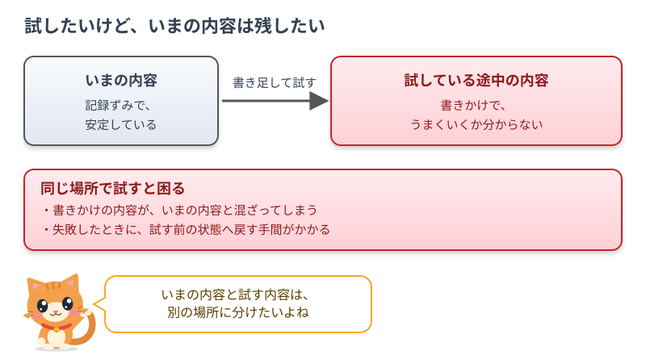
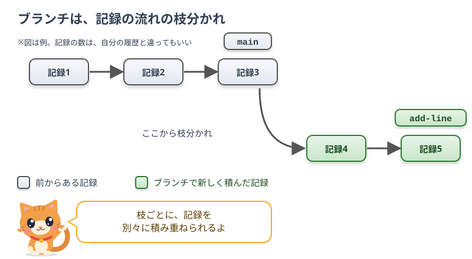
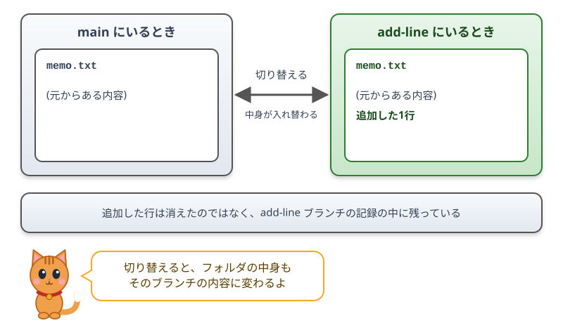
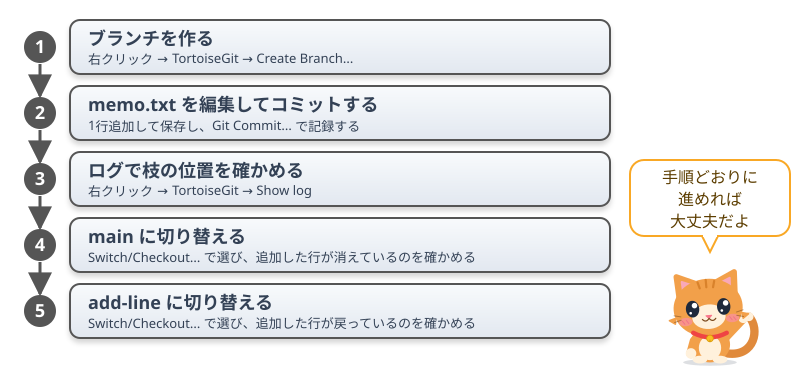
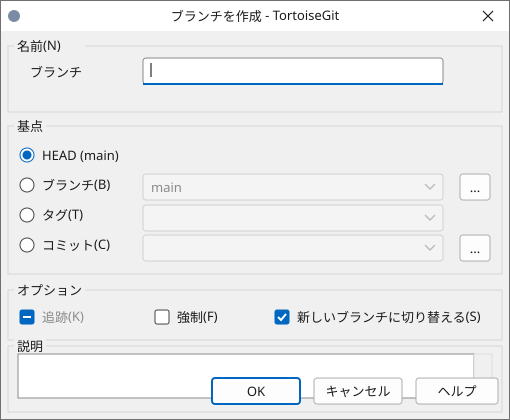

# 04 ブランチによる作業の分割

この章では、ブランチを使って作業を分ける方法を学ぶ。
ブランチは、記録の流れ（履歴）を途中から枝分かれさせて、作業を別々に進められるようにする仕組みだよ。履歴とは、記録を新しい順に並べたもののことだったね。
03章では、記録した変更を取り消す方法を学んだ。この章では、取り消す前に、別の場所で試すという考え方を学ぶ。
最後に、実際にブランチを作って切り替えて、memo.txt の中身が変わるのを確かめる。

## 1. なぜ作業を分けたいのか

### 試したいけど、いまの内容は残したい

ここまでで、memo.txt の変更を、コミット（記録する）で残せるようになった。
では、memo.txt に大きな変更を試したいときは、どうすればいいだろう。うまくいくかは分からないけれど、いまの内容は残しておきたい。

同じ場所で試すと、次のことが困りごとになる。

- 書きかけの内容が、いまの内容と混ざってしまう
- 失敗したときに、試す前の状態へ戻す手間がかかる

そこで、「いまの内容」と「試す内容」を、別々の場所に分けて進めたくなる。そのために使うのが、ブランチだよ。

> [!TIP]
> **復習**
>
> - 大きな変更を試すときも、いまの内容は（　　　）おきたい
> - 同じ場所で試すと、書きかけの内容が、いまの内容と（　　　）しまう
> - そこで、いまの内容と試す内容を（　　　）進めたくなる
>
> 

> 
答えを見る

>
> 1. 残して
> 2. 混ざって
> 3. 別々に
>
> 

## 2. ブランチとは

### 記録の流れを枝分かれさせる仕組み

ブランチ（branch）は、英語で「枝」という意味。
これまで積んできた記録の流れ、つまり履歴を、途中から枝分かれさせる。すると、別々に記録を積んで、作業を分けられる。この仕組みが、ブランチだよ。

何もしなければ、記録は「main」という名前の1本のブランチに積まれていく。main は、最初のブランチによく付く名前なんだ。ブランチは、最初から1本あったことになる。

イメージしやすいように、ゲームのセーブスロットにたとえてみる。
スロット1のセーブデータの途中から、スロット2を作る。スロット2は、スロット1のセーブの続きから始まって、そこから先は別々に進む。スロット1はそのまま残るから、スロット2では、安心して別の展開を試せるよね。

たとえと Git の対応は、次のとおり。

| ゲーム | Git |
|---|---|
| スロット1（いつものデータ） | main ブランチ |
| 途中から分けて、新しく作る | ブランチを作る |
| スロット2（別の展開を試すデータ） | 新しいブランチ |
| スロットを選び直す | ブランチを切り替える |
| スロットの中に並ぶセーブ | ブランチの中に並ぶ記録 |

分かれる前までのセーブは、2つのスロットで共通だよ。分かれたあとのセーブは、それぞれのスロットにだけ増えていく。
ブランチも同じで、分かれる前までの履歴は、2つのブランチで共通になる。

### 枝分かれしても、元の流れは変わらない

ブランチを作ると、記録の流れが途中から2本に分かれる。
2本のうち、いま作業の対象にしているほうを、「いま切り替えているブランチ」と呼ぶ。切り替え方は、このあとの節で学ぶ。
新しい記録は、いま切り替えているブランチのほうにだけ積まれる。もう一方のブランチの記録は、そのまま変わらない。

図の add-line は、このあとの練習で作るブランチの名前（例）だよ。図の記録の数も例で、自分の履歴とは違っていていい。

これなら、試した内容がうまくいかなくても、元の流れには影響がない。

> [!TIP]
> **復習**
>
> - ブランチは、記録の流れを（　　　）させる仕組みである
> - ブランチを作ると、新しい記録は、いま切り替えている（　　　）にだけ積まれる
> - ゲームにたとえると、ブランチは（　　　）に当たる
>
> 

> 
答えを見る

>
> 1. 枝分かれ
> 2. ブランチ
> 3. セーブスロット（スロット）
>
> 

### main と、切り替え

これまで記録を積んできた流れは、「main」という名前のブランチだよ。
いま切り替えているブランチは、記録の一覧を見る画面（ログ画面）で確かめられる。右クリックから TortoiseGit → Show log（ログを表示）を選ぶと、一番上の記録に、ブランチ名を書いた小さな札が付いて表示される場合が多い。この札を、ラベルと呼ぶ。

環境によっては、ラベルが「master」になっている。master も main も、最初のブランチを指している。ラベルが master の人は、この教材の「main」を「master」に読み替えてね。05章と06章でも、同じ読み替えで進める。

memo.txt などを置いて作業しているフォルダを、作業フォルダと呼ぶ。作業フォルダの中身は、いつも、いま切り替えているブランチの内容になっている。
別のブランチに変えることを、切り替えると言う。切り替えると、作業フォルダの中身が、そのブランチの内容に入れ替わる。スロットを選び直すと、遊べるデータが変わるのと同じだよ。

追加した行は、add-line ブランチの記録の中に残っている。add-line に切り替えれば、また現れる。

> [!TIP]
> **復習**
>
> - これまで記録を積んできた流れは、（　　　）という名前のブランチである
> - 別のブランチに変えることを（　　　）と言う
> - 切り替えると、作業フォルダの中の（　　　）が、そのブランチの内容に入れ替わる
>
> 

> 
答えを見る

>
> 1. main（環境によっては master）
> 2. 切り替える
> 3. ファイルの中身（memo.txt の中身）
>
> 

## 3. 手を動かす: ブランチを作って切り替える

ここからは、sample-project フォルダの memo.txt を使って、実際にブランチを作る。
memo.txt は、これまでの章で作って、何行か書いてあるものとする。最後の変更までは、コミットが済んでいる状態だよ。

操作は、右クリックのメニューから行う。メニューの名前は、TortoiseGit のバージョンや言語設定で、少し違うことがある。

### 手順1: ブランチを作る

1. sample-project フォルダの中の、何もない場所で右クリックする
2. TortoiseGit → Create Branch...（ブランチを作成）を選ぶ
3. ブランチの名前を入れる欄（Branch）に `add-line` と入力する
4. 作ったブランチにそのまま切り替えるチェック（Switch to new branch）にチェックを入れる
5. OK を押す

ブランチは、作っただけでは、いま切り替えているブランチは main のままだよ。切り替えまでしておくと、ここから add-line の上で作業できる。

### 手順2: memo.txt を編集してコミットする

1. memo.txt を開いて、最後に1行追加する。内容は何でもいい。たとえば「ブランチで追加した行」
2. 保存して、閉じる
3. sample-project フォルダの中で右クリックして、Git Commit...（記録する）を選ぶ
4. コミットメッセージに「memo.txtに1行追加」と入力して、`Commit`（記録する）ボタンを押す

手順3のメニューには、いま切り替えているブランチの名前が付いて、Git Commit -> "add-line"... のように表示される場合がある。同じ「記録する」操作だよ。

この章の練習で add-line に積む記録は、この1つだけ。この記録は、add-line ブランチにだけ積まれて、main には積まれない。

### 手順3: ログで枝の位置を確かめる

1. sample-project フォルダの中で右クリックして、TortoiseGit → Show log（ログを表示）を選ぶ
2. 記録の一覧を見る

一番上の記録に add-line、その1つ前の記録に main のラベルが付いて見える場合が多い。
add-line のほうが、記録が1つ多い状態だよ。

> [!TIP]
> **復習**
>
> - ブランチを作るときは、右クリックから TortoiseGit → （　　　）を選ぶ
> - add-line で記録した内容は、（　　　）には積まれない
> - add-line の記録は、main の記録より、記録が（　　　）つ多い
>
> 

> 
答えを見る

>
> 1. Create Branch...（ブランチを作成）
> 2. main
> 3. 1
>
> 

### 手順4: main に切り替えて確かめる

切り替える前に、まだコミットしていない変更が残っていないか確かめる。残っていると、切り替えがうまくいかないことがある。そのときは、先にコミットする。変更を捨てたいときは、03章の方法で元に戻す。

1. sample-project フォルダの中で右クリックして、TortoiseGit → Switch/Checkout...（ブランチを切り替え）を選ぶ
2. ブランチを選ぶ欄（Branch）で main を選んで、OK を押す
3. memo.txt を開く

ラベルが master だった人は、手順2で master を選ぶ。

手順2で追加した行が、なくなっていれば、切り替えができている。
消えたわけではなく、作業フォルダが main の内容に入れ替わっただけだよ。

### 手順5: add-line に切り替えて確かめる

1. もう一度 Switch/Checkout... を選んで、Branch で add-line を選び、OK を押す
2. memo.txt を開く

今度は、追加した行が戻っているよ。
確かめ終わったら、Switch/Checkout... で main に切り替えておく。add-line ブランチは、この章の練習用なので、そのまま残してよい。

> [!TIP]
> **復習**
>
> - main に切り替えると、add-line で追加した行は（　　　）ように見える
> - 追加した行は、実際には add-line の（　　　）の中に残っている
> - add-line に切り替えると、追加した行が（　　　）
>
> 

> 
答えを見る

>
> 1. 消えた
> 2. 記録
> 3. 戻る（また現れる）
>
> 

## 次の章へ

いまの main と add-line は、別々の内容のままだよ。
2つのブランチの内容を1つにまとめる方法は、次の章で学ぶ。次の章では、新しいブランチを作って進める。

次の章は、いま切り替えているブランチが main の状態から始める。ここまでの確認が終わったら、main に切り替えておいてね。

---

次の章: [05 マージによる変更の統合](./05_マージによる変更の統合.md)
