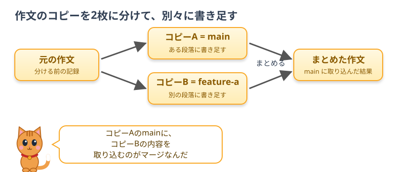
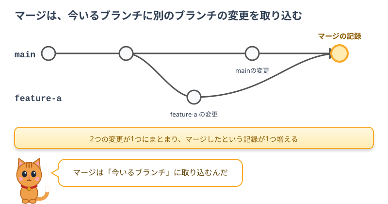
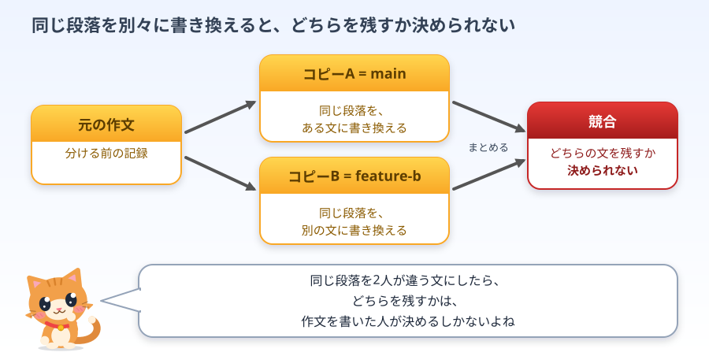
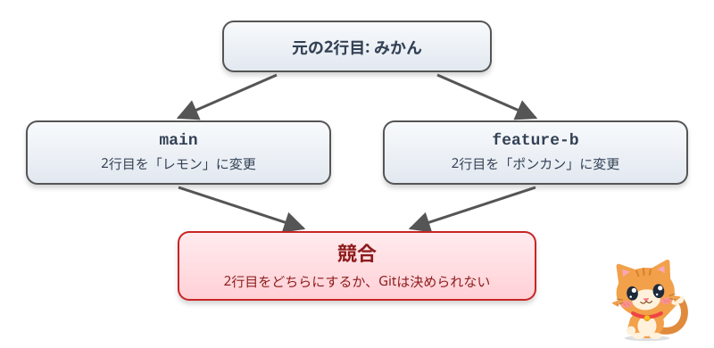
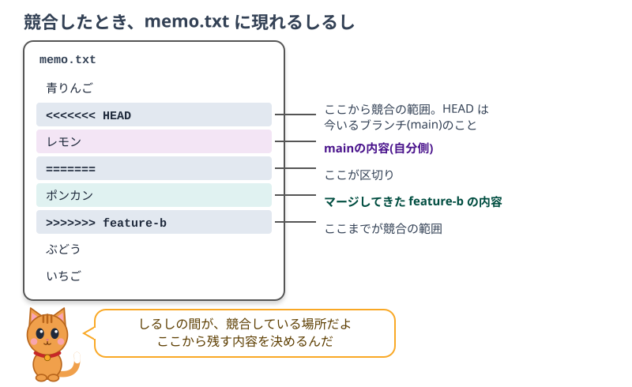
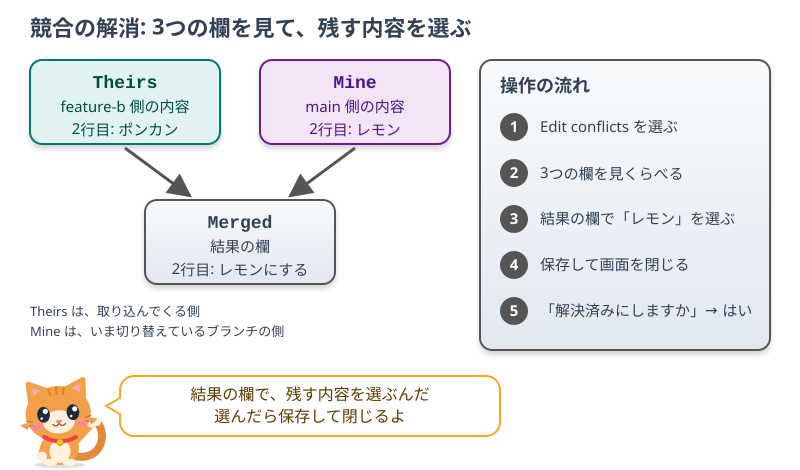

# 05 マージによる変更の統合

この章では、別々のブランチで進めた変更を1つにまとめる「マージ」を学ぶ。
同じ場所を別々に変えたときに起きる「競合」も、実際に起こして解消する。

> [!NOTE]
> この章のメニュー名は、英語の表記に日本語の意味を添えて書く。TortoiseGit のバージョンや言語設定で、表記が少し違うことがある。
> 最初のブランチの名前は、環境によって main か master になる。どちらでも同じものを指すよ。この章では main と呼んで進める。master になっている人は、main を master に読み替える。見分け方は、04章で学んだね。

## 1. マージとは何か

### ブランチで分けた作業は、まとめないと完成しない

ブランチを使うと、main の内容を変えずに、別の場所で作業を進められる。
でも、ブランチの中で進めた変更は、そのままでは main に入らない。main に入れて初めて、その作業は main の内容になる。

ブランチの変更を別のブランチに取り込むことを、マージ（merge）と呼ぶ。2つのブランチの変更を、1つにまとめる操作だよ。

### たとえ: 作文のコピー

04章では、ブランチをセーブスロットにたとえた。あれは、ブランチを「分ける」場面を考えるたとえだった。
ここでは、「まとめる」場面を考えやすい、別のたとえを使う。作文のコピーだ。

1. 元の作文をコピーして、2枚に分ける
2. コピーAとコピーBに、それぞれ別の段落を書き足す
3. 最後に、2枚の内容を1枚にまとめる



たとえと Git の対応は、次のとおり。

| 作文 | Git |
|---|---|
| 元の作文 | ブランチを分ける前の記録 |
| コピーA | main |
| コピーB | feature-a |
| コピーに書き足した内容 | ブランチで記録した変更 |
| 1枚にまとめる | マージ |

コピーAとコピーBは、どちらも元の作文から分かれた、同じ立場のコピーだ。
このあとの実習では、コピーAに当たる main に、コピーBに当たる feature-a の内容を取り込む。だから main も、変更を受け取る側になるんだ。

### マージで起きること

マージでは、いま切り替えているブランチに、別のブランチの変更が取り込まれる。
たとえば main に切り替えている状態で feature-a をマージすると、feature-a の変更が main に入る。



マージが終わると、マージしたという記録が1つ増える。あとから履歴を見たとき、いつ合流したのか分かるんだ。

> [!TIP]
> **復習**
>
> - ブランチの変更を、別のブランチに取り込むことを（　　　）と呼ぶ
> - マージでは、いま切り替えているブランチに、（　　　）の変更が取り込まれる
> - 作文のたとえで、「1枚にまとめる」ことは、Git の（　　　）に当たる
>
> <details>
> <summary>答えを見る</summary>
>
> 1. マージ
> 2. 別のブランチ
> 3. マージ
>
> </details>

## 2. 競合しないマージを試す

### 準備

02章から使っている `sample-project` フォルダで進める。
04章で作った add-line ブランチが残っていてもかまわない。この章では使わない。

まず、memo.txt の中身を、次の3行にそろえて記録しておく。記録する操作は、02章で学んだコミットだよ。

```text
りんご
みかん
ぶどう
```

1. `sample-project` フォルダを右クリックして、「TortoiseGit」→「Show log」（ログを表示）を選ぶ。一番新しい記録に、`main` と書かれた札（ラベル）が付いていれば、いま main に切り替えている。`master` と書かれていたら、master を main に読み替える。確認したら、画面を閉じる
2. `memo.txt` を開いて、中身を全部消してから、上の3行を入力して保存する
3. `sample-project` フォルダを右クリックして、「Git Commit -> "main"...」（記録する）を選ぶ。メニューに、いま切り替えているブランチの名前が付くことは、04章で見たよね。札が見当たらないときは、このメニューに付いた名前でも、いま切り替えているブランチが分かる
4. メッセージに「3行のメモにする」と入力して、コミットする

コミットしたあと、もう一度「Git Commit」のメニューを開いて、変更したファイルの一覧が空なら、記録し忘れはない。確認したら、画面を閉じる。

### feature-a ブランチを作る

1. `sample-project` フォルダを右クリックする
2. 「TortoiseGit」→「Create Branch...」（ブランチを作成）を選ぶ
3. 「Branch」に `feature-a` と入力する
4. 「Switch to new branch」（作ったブランチに切り替える）にチェックを入れて「OK」を押す

これで feature-a に切り替わった。

### feature-a で変更を記録する

1. `memo.txt` の最後に「いちご」の行を足して、保存する
2. `sample-project` フォルダを右クリックして、「Git Commit -> "feature-a"...」（記録する）を選ぶ
3. メッセージに「いちごを追加」と入力して、コミットする

feature-a の memo.txt は、次の4行になった。

```text
りんご
みかん
ぶどう
いちご
```

### main に切り替えて、別の変更を記録する

1. `sample-project` フォルダを右クリックして、「TortoiseGit」→「Switch/Checkout...」（ブランチを切り替え）を選ぶ
2. 「main」を選んで「OK」を押す
3. `memo.txt` を開いてみる。「いちご」の行がなくなって、3行に戻っている

切り替えると、フォルダの中身が、そのブランチの内容に入れ替わるんだ。「いちご」は feature-a の記録に残っている。feature-a に切り替えれば、また見えるよ。

4. 1行目の「りんご」を「青りんご」に変えて、保存する
5. 「Git Commit -> "main"...」で、メッセージ「1行目を青りんごに変更」を入力してコミットする

これで、main と feature-a が、別々の変更を持った状態になった。

| ブランチ | memo.txt の内容 |
|---|---|
| main | 青りんご、みかん、ぶどう |
| feature-a | りんご、みかん、ぶどう、いちご |

> [!TIP]
> **復習**
>
> - ブランチを切り替えると、フォルダの中身が、（　　　）の内容に入れ替わる
> - main に切り替えたとき「いちご」の行が見えなかったのは、「いちご」が（　　　）の記録に残っているからだ
> - この時点で、main と feature-a は、（　　　）変更を持っている
>
> <details>
> <summary>答えを見る</summary>
>
> 1. そのブランチ（切り替えた先のブランチ）
> 2. feature-a
> 3. 別々の
>
> </details>

### feature-a を main にマージする

1. いま切り替えているブランチが main であることを確認する
2. `sample-project` フォルダを右クリックして、「TortoiseGit」→「Merge...」（マージ）を選ぶ
3. 取り込むブランチとして `feature-a` を選んで、「OK」を押す
4. 結果の画面が出る。競合を知らせる表示が出ていなければ、マージは成功だよ

`memo.txt` を開いて、確かめてみよう。

```text
青りんご
みかん
ぶどう
いちご
```

main の「青りんご」と、feature-a の「いちご」が、どちらも入っている。
変えた場所が、離れた別々の行だったから、Git が自動で1つにまとめたんだ。

### 履歴で確認する

1. `sample-project` フォルダを右クリックして、「TortoiseGit」→「Show log」（ログを表示）を選ぶ
2. 一覧の一番上に、マージの記録が出ている。メッセージに、どのブランチをマージしたかが書かれている場合が多い

2つに分かれていた変更が、1つにまとまった形で並ぶよ。

> [!TIP]
> **復習**
>
> - マージするときは、まず（　　　）になるブランチに切り替えておく
> - main と feature-a で、離れた別々の行を変えていたので、Git が（　　　）で1つにまとめた
> - ログの一番上には、マージしたという（　　　）が出る
>
> <details>
> <summary>答えを見る</summary>
>
> 1. 取り込み先（変更を受け取る側）
> 2. 自動
> 3. 記録
>
> </details>

## 3. 競合とは何か

### 同じ場所を別々に変えると、決められない

さっきのマージが自動でうまくいったのは、変えた場所が離れた別々の行だったからだ。
今度は、同じファイルの同じ場所を、別のブランチで違う内容に変える。すると、どちらを残せばいいのか、Git には決められない。この状態を競合（コンフリクト）と呼ぶ。

| 変えた場所 | マージの結果 |
|---|---|
| 離れた別々の行 | Git が自動で1つにまとめる |
| 同じ行や、すぐ隣の行 | 競合になることがある |

作文のたとえなら、コピーAとコピーBで、同じ段落を違う文に書き換えたとき。どちらの文を残すか迷うよね。この例では、コピーAが main、コピーBが feature-b に当たるよ。





### 競合は、人が決めて解消する

競合は、失敗じゃない。複数のブランチで作業していれば、ふつうに起きることだよ。
競合が起きたら、どちらの内容を残すかを人が決めて、競合を解消する。決めたあとにコミットすると、マージが完了する。

> [!TIP]
> **復習**
>
> - 同じファイルの同じ場所を、別のブランチで違う内容に変えると（　　　）が起きる
> - 競合が起きたら、どちらの内容を残すかを（　　　）が決める
> - 離れた別々の行を変えたときは、Git が（　　　）で1つにまとめる
>
> <details>
> <summary>答えを見る</summary>
>
> 1. 競合（コンフリクト）
> 2. 人
> 3. 自動
>
> </details>

## 4. 競合を起こす

### feature-b で2行目を変える

「2. 競合しないマージを試す」の続きで、main の `memo.txt` が、次の4行になっている状態からはじめる。

```text
青りんご
みかん
ぶどう
いちご
```

いま main に切り替えているかは、「2. 競合しないマージを試す」の準備の手順1と同じ方法で確かめてから進めよう。

1. `sample-project` フォルダを右クリックして、「TortoiseGit」→「Create Branch...」（ブランチを作成）を選ぶ
2. 「Branch」に `feature-b` と入力して、「Switch to new branch」にチェックを入れ、「OK」を押す
3. `memo.txt` の2行目「みかん」を「ポンカン」に変えて、保存する
4. 「Git Commit -> "feature-b"...」（記録する）で、メッセージ「2行目をポンカンに変更」を入力してコミットする

### main で同じ2行目を変える

1. 「TortoiseGit」→「Switch/Checkout...」（ブランチを切り替え）で、main に切り替える
2. `memo.txt` の2行目「みかん」を「レモン」に変えて、保存する
3. 「Git Commit -> "main"...」で、メッセージ「2行目をレモンに変更」を入力してコミットする

これで、同じ2行目を、main と feature-b で違う内容に変えた状態になった。

### feature-b をマージする

main に切り替えている状態で、「TortoiseGit」→「Merge...」（マージ）から `feature-b` を選んで、「OK」を押す。
今度は、競合を知らせる表示が出て、マージが途中で止まる。表示の言葉は、環境で少し違うことがある。

これは、2行目をどちらにするか、Git が決められなかったからだよ。慌てなくていい。

> [!TIP]
> **復習**
>
> - 競合を起こすために、main と feature-b で、memo.txt の同じ（　　　）行目を別の内容に変えた
> - 競合があると、マージは（　　　）
> - 競合が起きたのは、どちらの内容を残すか、Git が（　　　）からだ
>
> <details>
> <summary>答えを見る</summary>
>
> 1. 2
> 2. 止まる
> 3. 決められなかった
>
> </details>

## 5. 競合の印を読む

### memo.txt に書き込まれる印

競合したとき、Git は memo.txt の中に、競合している場所を示す印を書き込む。
このあとの印には、`HEAD`（ヘッド）という言葉が出てくる。ここでは、いま切り替えているブランチ（main）のことだと思っておけばいい。

`memo.txt` をメモ帳などで開くと、次のように見える。ここでは、開いて見るだけにして、編集はしない。

```text
青りんご
<<<<<<< HEAD
レモン
=======
ポンカン
>>>>>>> feature-b
ぶどう
いちご
```



### 印の読み方

| 印 | 意味 |
|---|---|
| `<<<<<<< HEAD` | ここから競合の範囲 |
| `=======` | 区切り。上が main の内容、下が feature-b の内容 |
| `>>>>>>> feature-b` | ここまでが競合の範囲 |

つまり、2行目について「main では『レモン』、feature-b では『ポンカン』になっているよ。どちらにする？」と聞かれている状態なんだ。
印のない行（青りんご、ぶどう、いちご）は、競合していない。

> [!TIP]
> **復習**
>
> - `<<<<<<< HEAD` と `=======` の間には、いま切り替えているブランチ（　　　）の内容が入っている
> - `=======` と `>>>>>>> feature-b` の間には、マージしてきたブランチ（　　　）の内容が入っている
> - 印のない行は、競合して（　　　）
>
> <details>
> <summary>答えを見る</summary>
>
> 1. main
> 2. feature-b
> 3. いない
>
> </details>

## 6. 競合を解消する

### TortoiseGitMerge で、残す内容を選ぶ

競合を解消するための専用の画面が、TortoiseGit に付いている。TortoiseGitMerge という名前だよ。
この画面には、3つの欄が出る。上に Theirs と Mine の2つの欄が並び、下に Merged の欄がある、という並びで出ることが多い。

| 欄 | 中身 | 今回の2行目 |
|---|---|---|
| Theirs（取り込んでくる側） | feature-b の内容 | ポンカン |
| Mine（いま切り替えている側） | main の内容 | レモン |
| Merged（結果） | 最終的に残す内容。ここを決める | 選んだほうになる |

今回は、「レモン」を残すことにする。つまり、Mine 側を採用する。

1. `memo.txt` を右クリックして、「TortoiseGit」→「Edit conflicts」（競合を編集）を選ぶ
2. TortoiseGitMerge が開く。Theirs・Mine・Merged の3つの欄を見くらべる
3. Merged の欄にある、競合している2行目を右クリックして、「Use text block from 'mine'」（Mine 側のかたまりを使う）を選ぶ。2行目が「レモン」になる
4. 保存して、画面を閉じる
5. 「解決済みにしますか」のような確認が出たら、「はい」を選ぶ。確認が出なかったときは、次の「解消したと Git に伝える」に進む



### 解消したと Git に伝える

上の手順5で確認が出て、「はい」を選んだなら、この手順は要らない。
確認が出なかったときや、迷ったときは、実行してかまわない。

1. `memo.txt` を右クリックして、「TortoiseGit」→「Resolve...」（解決済みにする）を選ぶ
2. `memo.txt` を選んで、「Resolved」を押す

これで、この競合は解決済みになった。

### コミットしてマージを完了する

1. `sample-project` フォルダを右クリックして、「Git Commit -> "main"...」（記録する）を選ぶ
2. メッセージは、最初から入っているままでかまわない
3. コミットする

コミットすると、マージが完了する。

### 結果を確認する

`memo.txt` を開いて、次の内容になっていれば成功だよ。

```text
青りんご
レモン
ぶどう
いちご
```

`<<<<<<<` などの印が消えて、2行目が「レモン」になっている。
「TortoiseGit」→「Show log」（ログを表示）で見ると、feature-b をマージした記録が増えているよ。

> [!TIP]
> **復習**
>
> - TortoiseGitMerge で、マージしてきたブランチの内容が出る欄は（　　　）で、いま切り替えているブランチの内容が出る欄は Mine だ
> - 最終的に残す内容を決める欄は（　　　）だ
> - 競合を解消したと Git に伝えるときは、「Resolve...」の画面で memo.txt を選んで（　　　）を押す
> - 競合を解消したあと、（　　　）してマージを完了する
>
> <details>
> <summary>答えを見る</summary>
>
> 1. Theirs
> 2. Merged
> 3. Resolved
> 4. コミット
>
> </details>

ここまでで、自分のパソコンの中で、ブランチを分けて、まとめる流れができた。
次の06章では、他の人と変更を共有する方法を学ぶ。

---

次の章: [06 複数人での変更共有](./06_複数人での変更共有.md)
