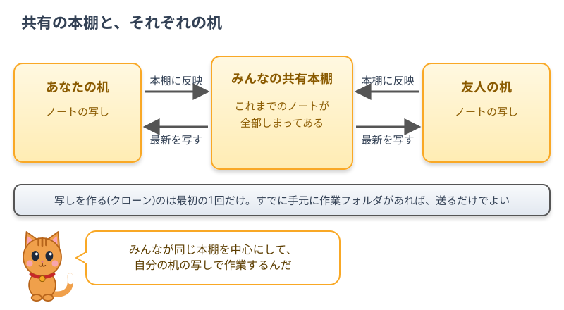
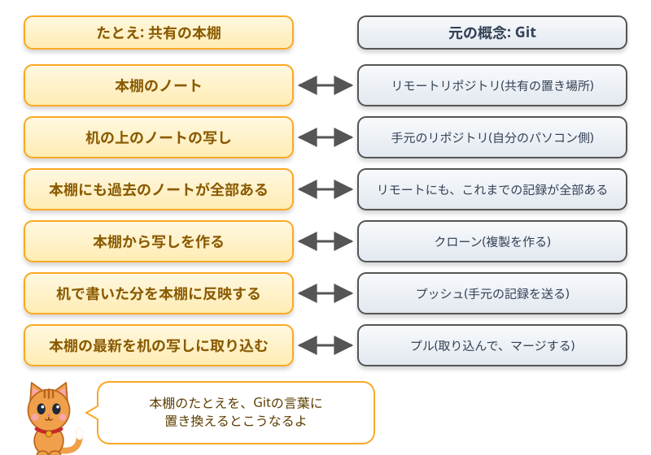
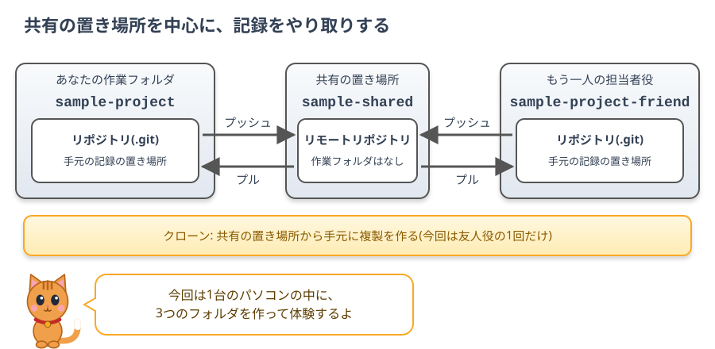
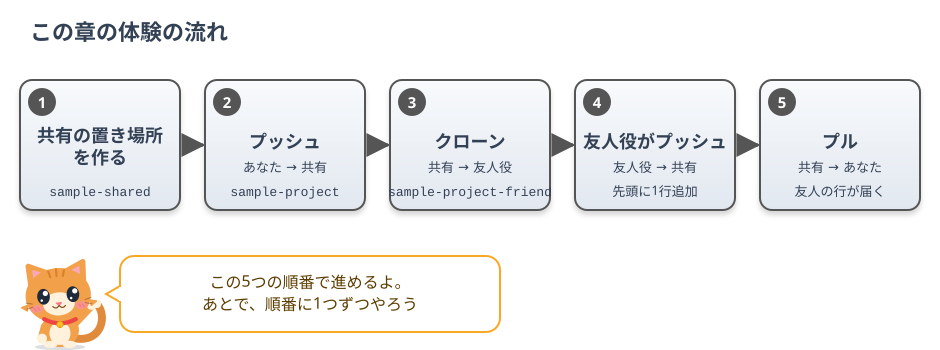
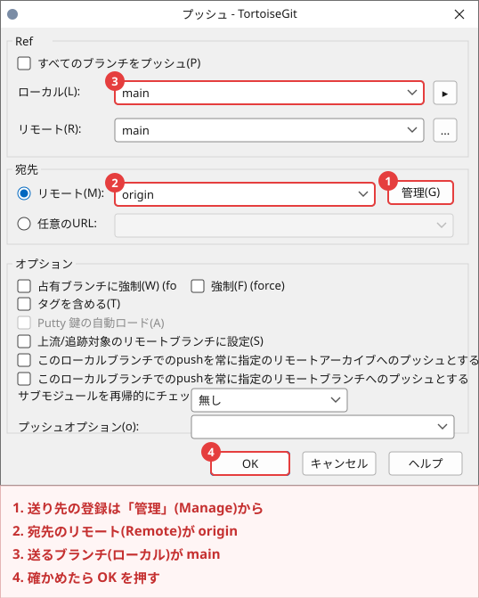
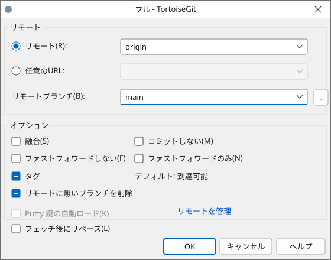
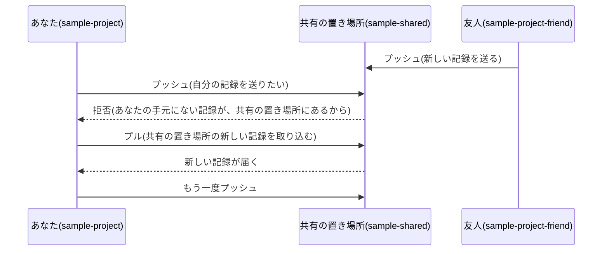

# 06 複数人での変更共有

この章では、複数人で同じファイルを扱うときの、記録の共有のしかたを学ぶ。
結論は、みんなが同じ場所を見て作業できるように、記録を集めておく場所を一つ決めて、そことやり取りする、ということ。この場所を、共有の置き場所と呼ぶよ。
最後に、1台のパソコンの中で2人分の役を演じて、実際に記録を共有してみよう。

この章は、これまでの章で使ってきた `sample-project` フォルダがある前提で進める。
なお、TortoiseGit のメニュー名は、バージョンや言語設定で表記が少し違うことがある。この章では、英語の表記に日本語の意味を添えて書く。

## 1. なぜ共有の置き場所が必要か

### 複数人で同じファイルを扱うと困る

仕事では、複数人で同じファイルを書き換えることがある。
もしお互いのパソコンにファイルをコピーして、メールで送り合っていたら、どうなるだろう。01章で見たコピーの困りごとが、人数分に増えてしまうんだ。

- どれが一番新しいファイルなのか、分からなくなる
- 同じ場所を2人が書き換えて、どちらを残すか迷う
- 自分が書き換えている間に、相手が先に書き換えていたことに気づけない

記録を残す仕組みがあっても、記録をやり取りする場所が決まっていないと、同じ困りごとが起きる。
だから、みんなが同じ場所を見て、同じ場所とやり取りする形にしたいんだ。

### 共有の本棚にたとえる

この仕組みは、共有の本棚にたとえると分かりやすい。

- 教室の共有の本棚に、古いものから最新のものまで、これまでのノートが全部しまってある
- みんなは、本棚のノートの写しを作って、自分の机に持っていく
- 机の上の写しに書き込んだら、本棚のノートにも反映する
- 友人が反映した内容は、あとで自分の机の写しにも取り込む

このたとえは、Git では次のことに当たる。

表に出てくる名前を、先に日常の言葉で見ておこう。
リモートリポジトリは、みんなで共有する記録の置き場所のこと。手元のリポジトリは、自分のパソコンにある記録の置き場所のこと。
クローン、プッシュ、プルの意味は、次の節で説明するよ。

| 共有の本棚 | Git |
|---|---|
| 本棚のノート | リモートリポジトリ(共有の置き場所) |
| 机の上のノートの写し | 手元のリポジトリ(自分のパソコン側) |
| 本棚にも過去のノートが全部ある | リモートリポジトリにも、これまでの記録が全部ある |
| 本棚から写しを作る | クローン |
| 机で書いた分を本棚に反映する | プッシュ |
| 本棚の最新を机の写しに取り込む | プル |

プルでは、共有の置き場所の新しい記録を取り込んだあとで、自分の記録と合わせる。この「合わせる」のが、05章で学んだマージだよ。

> [!TIP]
> **復習**
>
> - 記録をやり取りする場所が決まっていないと、どれが（　　　）か分からなくなる
> - 共有の本棚のノートは、Git の（　　　）に当たる
> - 机の上のノートの写しは、Git の（　　　）に当たる
>
> 

> 
答えを見る

>
> 1. 最新（一番新しいもの）
> 2. リモートリポジトリ（共有の置き場所）
> 3. 手元のリポジトリ（自分のパソコン側の記録の置き場所）
>
> 

## 2. クローン・プッシュ・プルの意味

### リモートリポジトリと手元のリポジトリ

リモートリポジトリは、みんなで共有する記録の置き場所のこと。
リポジトリとは、02章で学んだとおり、ファイルの記録をしまっておく場所だよ。
「リモート」は「離れた場所にある」という意味で、自分のパソコンとは別の場所にある置き場所を指す。

これに対して、自分のパソコンにある記録の置き場所を、手元のリポジトリと呼ぶ。
手元のリポジトリは、作業フォルダ `sample-project` の中の `.git` のこと。02章で学んだ、記録をしまっておく場所だよ。

実際の仕事では、インターネット上のサービスを、共有の置き場所として使うことが多い。
この章では、その代わりにパソコンの中のフォルダを使う。

### 3つの操作

リモートリポジトリと手元のリポジトリの間で、記録をやり取りする操作が3つある。

- クローン: リモートリポジトリから、手元に複製を作る。作業フォルダがまだない人が、最初に1回だけ行う
- プッシュ: 手元の記録を、リモートリポジトリに送る
- プル: リモートリポジトリにある新しい記録を、手元に取り込む

プッシュは「送る」、プルは「取り込む」と覚えておけばいい。

この図の3つのフォルダを、次の節から実際に作る。

> [!TIP]
> **復習**
>
> - みんなで共有する記録の置き場所を、（　　　）と呼ぶ
> - 手元の記録を共有の置き場所に送る操作を、（　　　）と呼ぶ
> - 共有の置き場所にある新しい記録を手元に取り込む操作を、（　　　）と呼ぶ
> - 共有の置き場所から手元に複製を作る操作を、（　　　）と呼ぶ
>
> 

> 
答えを見る

>
> 1. リモートリポジトリ
> 2. プッシュ
> 3. プル
> 4. クローン
>
> 

## 3. 共有の置き場所を作って、記録を送る

### 準備: 3つのフォルダと体験の流れ

本当は2人が別々のパソコンを使うけれど、今回は1台のパソコンで、2人分の役を演じる。
共有の置き場所は、パソコンの中のフォルダで代わりにする。

| フォルダ | 役割 |
|---|---|
| `sample-project` | あなたの作業フォルダ(これまで使ってきたもの) |
| `sample-shared` | 共有の置き場所(これから作る) |
| `sample-project-friend` | もう一人の担当者の作業フォルダ(これから作る) |

3つとも、同じ親フォルダの中に並べて置く。

この体験は、次の5つの順番で進める。

### 準備: sample-project の状態を確かめる

プッシュで送られるのは、いま切り替えているブランチの記録だけ。
`add-line` や `feature-a` など、ほかのブランチの記録は送られない。
そこで、`main` に切り替えて、変更をすべて記録し終えた状態にしてから始める。

1. 04章で学んだ方法で、いま切り替えているブランチが `main` か確かめる。違うときは、`sample-project` フォルダを右クリックして、「TortoiseGit」→「Switch/Checkout...」（ブランチを切り替え）で `main` を選ぶ
2. `sample-project` フォルダを右クリックして、「Git Commit -> "main"...」（記録する）を開く。この画面には、まだ記録していない変更のあるファイルが、一覧で出る。一覧が空なら、変更はすべて記録済みだよ。確かめたら、画面を閉じる
3. `memo.txt` を開いて、3行以上あることを確かめる。05章を終えていれば入っている

環境によっては、最初のブランチの名前が `main` ではなく `master` のことがある。そのときは、この章の `main` を `master` に読み替えてね。

### 手順1: 共有の置き場所を作る

共有の置き場所は、みんなが記録を送り込むだけの場所で、ファイルを直接編集することはない。
だから、作業フォルダを持たない、記録だけの置き場所として作る。
TortoiseGit では、そのための設定が `Make it Bare`（記録だけの置き場所にする）というチェック欄だよ。

1. `sample-project` と同じ場所に、`sample-shared` という名前の空のフォルダを作る
2. `sample-shared` フォルダを右クリックして、「TortoiseGit」→「Create repository here...」（ここにリポジトリを作成）を選ぶ
3. 表示された画面で、`Make it Bare` にチェックを入れて、OK を押す

### 手順2: sample-project の記録を共有の置き場所に送る(プッシュ)

プッシュするには、送り先がどこなのかを、Git に教える必要がある。
そのために、送り先に名前を付けて登録しておく。名前は何でもいいけれど、共有の置き場所には `origin` と付けるのが慣習なんだ。
TortoiseGit では、プッシュの画面の `Remote`（送り先）の横にある `Manage`（管理）ボタンから登録する。

1. `sample-project` フォルダを右クリックして、「TortoiseGit」→「Push...」（プッシュ）を選ぶ
2. 表示された画面の `Remote` の横にある `Manage` を押す
3. 開いた設定の画面で、送り先を新しく追加する操作を選ぶ
4. 送り先の名前の欄に、`origin` と入れる
5. 送り先の場所の欄に、`sample-shared` フォルダの場所(`C:\...\sample-shared` のようなパス)を入れる
6. 保存して、設定の画面を閉じる
7. プッシュの画面に戻って、`Remote` が `origin`、送るブランチが `main` になっていることを確かめて、OK を押す

これで、`sample-project` の `main` の記録が、`sample-shared` に送られた。

> [!TIP]
> **復習**
>
> - 今回の共有の置き場所は、パソコンの中の（　　　）フォルダで代わりにする
> - 共有の置き場所を作るときは、`Make it Bare` に（　　　）を入れる
> - プッシュで送られるのは、いま切り替えている（　　　）の記録だけである
> - `sample-project` の記録を共有の置き場所に送る操作は、（　　　）である
>
> 

> 
答えを見る

>
> 1. `sample-shared`
> 2. チェック
> 3. ブランチ（`main`）
> 4. プッシュ
>
> 

## 4. クローンして、記録をやり取りする

### 手順3: 共有の置き場所から複製を作る(クローン)

あなたの `sample-project` は、作業フォルダがすでにある。だから、あなたはクローンしなくていい。手順2のプッシュで、記録を共有の置き場所に送るだけで足りる。
クローンするのは、作業フォルダがまだない、もう一人の担当者の分だけだよ。

1. 3つのフォルダを置く親フォルダを開いて、フォルダの中のファイルがない余白を右クリックする
2. 「Git Clone...」（クローン）を選ぶ
3. `URL`（複製元の場所）に、`sample-shared` フォルダの場所を入れる
4. `Directory`（複製先）に、親フォルダの中の `sample-project-friend` を指定して、OK を押す

`URL` は、ふつうはインターネットのアドレスを入れる欄。今回は共有の置き場所がパソコンの中のフォルダなので、そのフォルダの場所を入れるよ。

`sample-project-friend` フォルダができて、中には `sample-project` の `main` と同じファイルと記録が入っている。
`memo.txt` が入っていることを確かめてみよう。

環境によっては、複製した直後に `main` が選ばれていないことがある。`memo.txt` が見当たらないときは、`sample-project-friend` フォルダを右クリックして、「TortoiseGit」→「Switch/Checkout...」（ブランチを切り替え）で `main` を選んでみてね。

これで、もう一人の担当者の作業フォルダができた。本棚のたとえでは、友人の机の写しに当たるよ。

### 手順4: もう一人の担当者として記録を送る

1. `sample-project-friend` フォルダの中の `memo.txt` を開いて、先頭に1行書き足して保存する
2. 02章と同じ手順で、「Git Commit -> "main"...」（記録する）を使って記録する。コミットメッセージは「友人の行を追加」とする
3. `sample-project-friend` フォルダを右クリックして、「TortoiseGit」→「Push...」（プッシュ）を選び、OK を押す

もう一人の担当者の書き足しが、共有の置き場所に送られた。

### 手順5: あなたの作業フォルダに取り込む(プル)

1. `sample-project` フォルダを右クリックして、「TortoiseGit」→「Pull...」（プル）を選び、OK を押す。取り込み元を聞かれたら、`origin` の `main` を選ぶ
2. `sample-project` フォルダの `memo.txt` を開く

さっき友人役で書き足した先頭の1行が、`memo.txt` に入っていれば成功だよ。
共有の置き場所を使って、友人の変更があなたの作業フォルダに届いたんだ。

> [!TIP]
> **復習**
>
> - 共有の置き場所から手元に複製を作る操作を、（　　　）と呼ぶ
> - 今回、クローンしたのは、作業フォルダがまだない（　　　）役のフォルダだけである
> - 友人役で書き足した行を、あなたの作業フォルダに取り込む操作を、（　　　）と呼ぶ
> - 友人役の変更を共有の置き場所に送るには、先に（　　　）してから、プッシュする
>
> 

> 
答えを見る

>
> 1. クローン
> 2. 友人（もう一人の担当者）
> 3. プル
> 4. コミット（記録）
>
> 

## 5. 他の人が先に送っていたら

### プッシュの前にプルする

2人が同じタイミングで作業すると、片方が先にプッシュすることがある。
そのとき、あとからプッシュしようとしても、共有の置き場所には、自分の手元にない記録がすでにある。この状態では、プッシュは拒否される。
そのままプッシュすると、あなたの記録に置き換わって、先に送られた友人の記録が、共有の置き場所から消えてしまうからだよ。
拒否は失敗ではなく、友人の記録を守るための正しい動きなんだ。

だから、先にプルして、共有の置き場所の新しい記録を手元に取り込んでから、もう一度プッシュする。
この順番が、複数人で作業するときの基本の流れだよ。

次の図は、上から下へ時間が進む。実線の矢印は、記録を送る操作を表す。点線の矢印は、共有の置き場所からの返事を表す。

プルでは、友人の記録を取り込んだうえで、あなたの記録と合わせる。この「合わせる」のが、05章で学んだマージだよ。

### 実際に試す

1. `sample-project` の `memo.txt` の末尾に、別の1行を書き足して、記録する(まだプッシュしない)
2. `sample-project-friend` の `memo.txt` の先頭に、別の1行を書き足して、記録し、プッシュする
3. `sample-project` からプッシュしようとして、拒否されることを確かめる
4. `sample-project` でプルして、友人の行を取り込む
5. もう一度プッシュする

今回は、あなたが末尾、友人が先頭と、離れた場所を書き換えた。だから、プルで自動で1つにまとめられる。
近い行や同じ場所を2人が書き換えたときは、競合が起きる。そのときは、[05章](./05_マージによる変更の統合.md)の方法で解消して、記録してから、プッシュする。

> [!TIP]
> **復習**
>
> - 他の人が先にプッシュしていると、あとからのプッシュは（　　　）される
> - その場合は、先に（　　　）して、共有の置き場所の新しい記録を取り込んでから、プッシュする
> - 近い行や同じ場所を2人が書き換えて、自動でまとめられないものを（　　　）と呼ぶ
>
> 

> 
答えを見る

>
> 1. 拒否
> 2. プル
> 3. 競合
>
> 

ここまでで、記録を残す、取り消す、ブランチで分ける、マージでまとめる、みんなで共有する、という一通りの流れを体験したね。
複数人で作業するときは、プッシュの前に、まずプルすることを忘れないでね。
次の07章では、これまでの章で学んだ操作を組み合わせて、総合演習に取り組む。

---

次の章: [07 総合演習](./07_総合演習.md)
