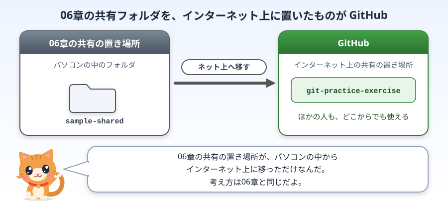
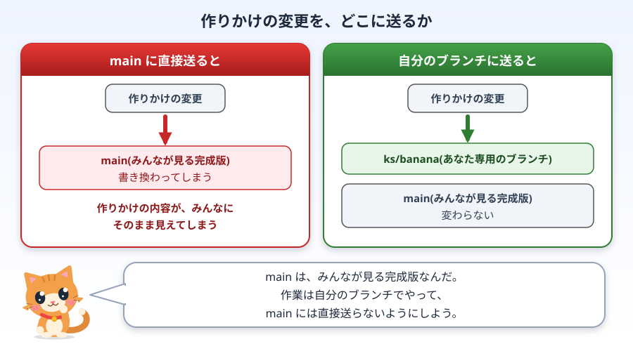
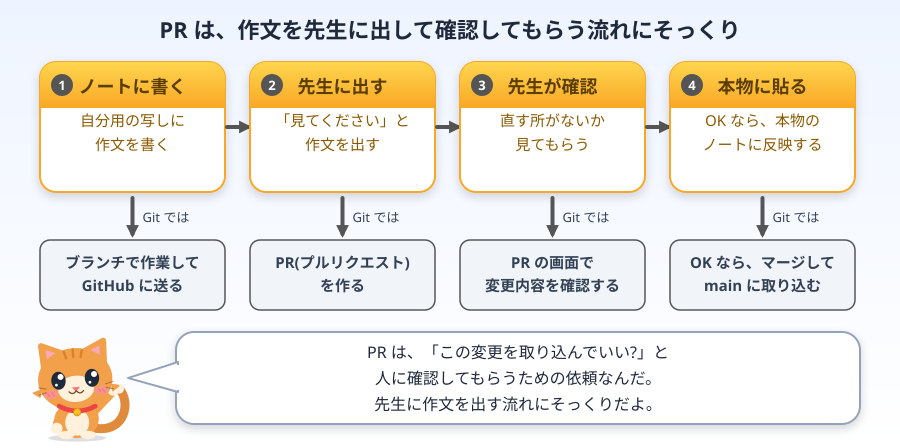
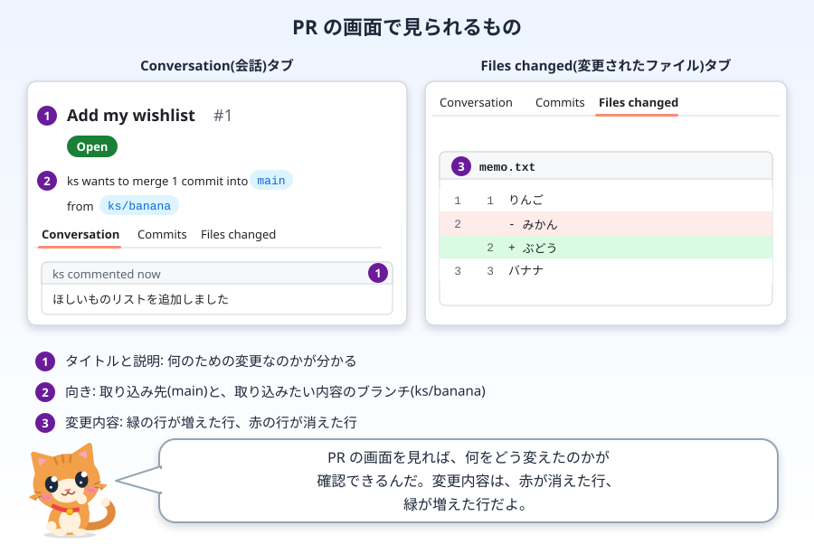
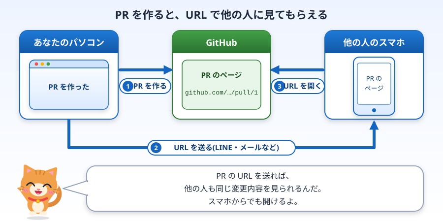
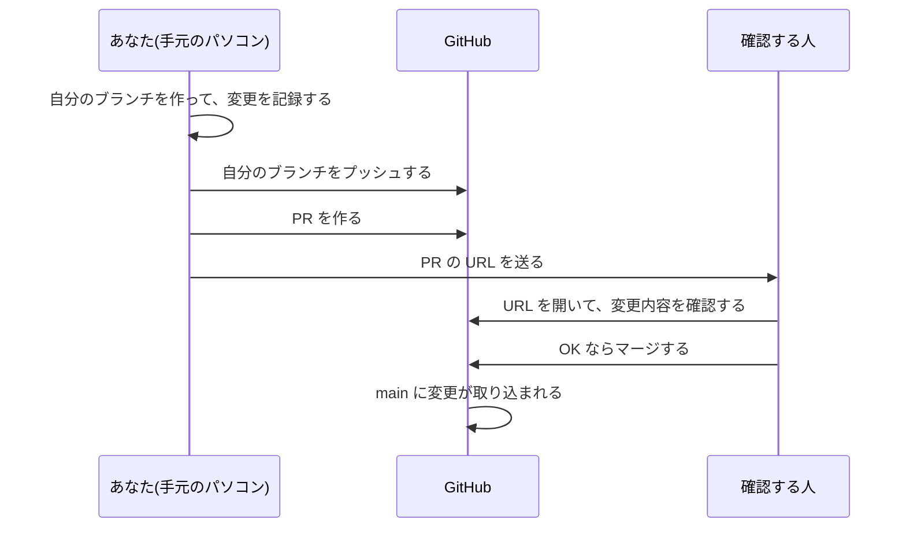

# 07 GitHubとプルリクエスト

この章では、仕事で共有の置き場所として使われる GitHub と、変更を取り込む前に確認してもらう仕組み、プルリクエストを学ぶ。
結論は、共有の置き場所をインターネット上に置いたものが GitHub だということ。
「この変更を取り込んでいいか見てください」という依頼が、プルリクエストだよ。

この章は、読んで仕組みを理解する章だよ。手を動かさなくていい。
次の08章で、GitHub を使って実際に体験する。

## 1. GitHub とは

### 共有の置き場所を、インターネット上に置いたもの

06章では、共有の置き場所を `sample-shared` というフォルダで代わりにした。1台のパソコンの中で、2人分の役を演じたんだったね。
実際の仕事では、フォルダではなく、インターネット上のサービスを使う。その代表が GitHub だよ。

GitHub は、Git の記録を置いておく共有の置き場所を、インターネット上で貸してくれるサービス。
インターネットにつながっていれば、どのパソコンからでも、ほかの人も使える。

06章の言葉と並べると、次のように対応する。

| 06章 | GitHub |
|---|---|
| 共有の置き場所 `sample-shared`(パソコンの中のフォルダ) | GitHub 上のリポジトリ(インターネット上) |
| 使えるのは、そのパソコンを使える人だけ | インターネットにつながれば、ほかの人も使える |
| プッシュ・プル・クローンで記録をやり取りする | 同じ。送り先が GitHub になるだけ |

GitHub 上のリポジトリも、06章で学んだリモートリポジトリの一つだよ。
プッシュで記録を送り、プルで取り込む操作は、06章と変わらない。

次の08章では、この教材用に用意した `git-practice-exercise` というリポジトリを使う。

> TODO: 演習用リポジトリのリンク

> [!TIP]
> **復習**
>
> - 06章で共有の置き場所の代わりにしたのは、パソコンの中の（　　　）だった
> - 共有の置き場所を、インターネット上で貸してくれるサービスを（　　　）と呼ぶ
> - GitHub 上のリポジトリも、（　　　）リポジトリの一つである
>
> 

> 
答えを見る

>
> 1. フォルダ(`sample-shared`)
> 2. GitHub
> 3. リモート
>
> 

## 2. main と、自分のブランチ

### main は、みんなが見る完成版

04章で、最初のブランチは `main` だと学んだね。
みんなで共有するときの `main` は、みんなが「最新の完成版」として見る場所になる。

もし作りかけの変更を、`main` に直接プッシュしたら、どうなるだろう。

- `main` が書き換わって、みんなが見る完成版に、作りかけの内容が混ざる
- ほかの人がプルすると、作りかけの内容が自分のパソコンにも入ってくる
- 間違いに気づいても、元に戻すには手間がかかる

そこで、自分の作業は、自分専用のブランチで行う。
作ったブランチをプッシュしても、`main` は変わらない。完成版は、みんなが見ているそのままの形で残るんだ。

> [!NOTE]
> 08章で使う演習用リポジトリは、`main` に直接プッシュできないように、守ってある。
> それでも、プッシュする前に、送り先が自分のブランチになっているかを確かめる習慣をつけよう。守られていないリポジトリもあるからね。

> [!TIP]
> **復習**
>
> - みんなで共有するときの `main` は、みんなが見る（　　　）になる
> - 作りかけの変更を `main` に直接プッシュすると、完成版に（　　　）の内容が混ざる
> - 作業は、自分専用の（　　　）で行い、そのブランチをプッシュする
>
> 

> 
答えを見る

>
> 1. 完成版(最新の完成版)
> 2. 作りかけ
> 3. ブランチ
>
> 

## 3. プルリクエスト(PR)とは

### 変更を取り込んでよいか、確認してもらう依頼

自分のブランチをプッシュしても、`main` は変わらない。
変更を `main` に取り込むには、05章で学んだマージをする。

ただ、仕事では、マージする前に、ほかの人に確認してもらうことが多い。間違いや、直したほうがいい所がないかを、見てもらうためだよ。
その依頼のことを、プルリクエストと呼ぶ。「PR(ピーアール)」と略すことが多い。

作文にたとえてみよう。

- 自分用のノートの写しに、作文を書く
- 先生に「見てください」と作文を出す
- 先生が、直す所がないか確認する
- OK なら、本物のノートに反映してもらう

このたとえは、Git では次のことに当たる。

| 作文のたとえ | Git・GitHub |
|---|---|
| 自分用のノートの写し | 自分のブランチ |
| 先生に作文を出す | PR を作る |
| 先生が確認する | PR の画面で、変更内容を確認する |
| 本物のノートに反映する | マージして、`main` に取り込む |

> [!WARNING]
> 「プルリクエスト」には「プル」と付くけれど、06章で学んだ、手元に取り込む操作の「プル」とは別のものだよ。
> プルリクエストは、「この変更を取り込んでください」とお願いする依頼のことなんだ。

> [!TIP]
> **復習**
>
> - 変更を取り込む前に、ほかの人に確認してもらう依頼を、（　　　）と呼ぶ
> - PR を作ることは、作文のたとえでは、先生に作文を（　　　）ことに当たる
> - OK が出たら、（　　　）して、`main` に取り込む
>
> 

> 
答えを見る

>
> 1. プルリクエスト(PR)
> 2. 出す
> 3. マージ
>
> 

### PR の画面で見られるもの

PR を作ると、GitHub 上に、その PR 専用のページができる。
確認する人は、このページを見て、変更内容を確かめる。

見られるものは、主に3つあるよ。

- タイトルと説明: 何のための変更なのかを書いたもの。PR を作る人が書く
- 向き: どのブランチを、どのブランチに取り込みたいか。左の図では、`ks/banana` を `main` に取り込みたい、という意味になる
- 変更内容: 02章で学んだ差分。増えた行は緑、消えた行は赤で示される

取り込み先は、`main` とは限らない。`main` 以外のブランチを、取り込み先に選ぶこともできる。08章の体験③で使うよ。

PR を作っただけでは、`main` は変わらない。マージするまでは、確認してもらうための依頼のままなんだ。

> [!TIP]
> **復習**
>
> - PR のページでは、変更内容を（　　　）として確かめられる
> - 差分では、増えた行は（　　　）、消えた行は赤で示される
> - PR を作っただけでは、`main` は（　　　）
>
> 

> 
答えを見る

>
> 1. 差分
> 2. 緑
> 3. 変わらない
>
> 

### PR には URL がある

PR のページには、URL(ブラウザで開くときのアドレス)がある。
この URL を LINE やメールで送れば、受け取った人は、あなたの変更内容を見られる。
ブラウザでもスマホでも開けるよ。

08章では、自分で作った PR の URL を、自分のスマホに送って開く。
他の人があなたの変更を見られる、ということを、実際に体験してみよう。

> [!TIP]
> **復習**
>
> - PR のページには（　　　）があり、送れば他の人も同じページを開ける
> - URL を受け取った人は、スマホや PC の（　　　）で開けば、PR のページを見られる
>
> 

> 
答えを見る

>
> 1. URL
> 2. ブラウザ
>
> 

## 4. 全体の流れ

ここまでの話を、順番にまとめるよ。
あなたと、確認してくれる人と、GitHub の間で、次のようにやり取りする。

08章の体験では、次の3つを順に行う。

1. 新しいファイルを作って、PR を作る(URL をスマホに送って、開いてみる)
2. すでにあるファイルを編集して、PR を作る(変更内容の差分を見る)
3. ②のブランチからさらにブランチを作って、取り込み先を②のブランチにして、PR を作る

どの体験も、`main` には取り込まないよ。

> [!TIP]
> **復習**
>
> - PR を作る前に、自分のブランチを GitHub に（　　　）しておく
> - 確認してくれる人には、PR の（　　　）を送って、ページを開いてもらう
> - 確認して OK なら、（　　　）して、変更が `main` に取り込まれる
>
> 

> 
答えを見る

>
> 1. プッシュ
> 2. URL
> 3. マージ
>
> 

## 次の章へ

この章では、共有の置き場所をインターネット上に置いたものが GitHub だと学んだ。
そして、変更を取り込む前に確認してもらう依頼が PR だということも学んだ。
次の08章では、GitHub を使って、ブランチを作ってから PR を作るまでを、実際に体験する。

---

次の章: [08 Git操作を体験する](./08_Git操作を体験する.md)
