# 08 Git操作を体験する

この章では、07章で学んだ GitHub とプルリクエスト(PR)を、実際に使って体験する。
仕事でよくある流れを、3つの体験で順番にやってみよう。

1. 新しいファイルを作って、PR を作る
2. すでにあるファイルを書き換えて、PR を作る
3. ②のブランチからさらにブランチを作って、PR を作り、マージする

ここまでの章で学んだ、ブランチ、コミット、プッシュ、プルを使うよ。
TortoiseGit のメニュー名は、バージョンや言語設定で表記が少し違うことがある。この章では、英語の表記に日本語の意味を添えて書く。

## 1. 準備

### 3つの体験の全体像

3つの体験で作る PR と、取り込み先は、次のとおりだよ。

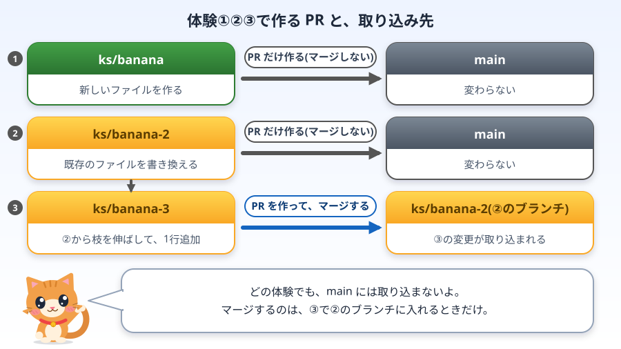

- ①と②は、PR を作るところまで。マージはしない
- ③だけは、取り込み先を `main` ではなく、②のブランチにして、マージまでやる
- どの体験でも、`main` は変わらない

### ブランチの名前

自分のブランチの名前は、「自分のイニシャル/好きなフルーツの名前」にする。
たとえば、イニシャルが `ks` で、好きなフルーツがバナナなら、`ks/banana` だよ。

- 半角の英数字で書く
- イニシャルとフルーツの間は `/`(スラッシュ)で区切る

この章では、`ks/banana` を例にして書く。自分のイニシャルとフルーツ名に読み替えてね。
体験②のブランチは `ks/banana-2`、体験③のブランチは `ks/banana-3` のように、後ろに番号を付ける。

作るファイルの名前も、同じイニシャルを使う。たとえば `wishlist-ks.txt` だよ。

### 演習用リポジトリを手元に複製する(クローン)

体験には、この教材用に用意した、GitHub 上の演習用リポジトリ `git-practice-exercise` を使う。
06章で学んだクローンで、自分のパソコンに複製しよう。

> TODO: 演習用リポジトリのリンク

1. 複製先にしたいフォルダーを、エクスプローラーで開く(たとえば「ドキュメント」)
2. フォルダーの中の何もない場所で右クリックして、「Git Clone...」(クローン)を選ぶ
3. `URL` の欄に、演習用リポジトリの URL を入れる
4. `Directory`(複製先)の欄に、複製先のフォルダーの場所が入っていることを確かめる。最後が `git-practice-exercise` になっていればいい
5. OK を押す

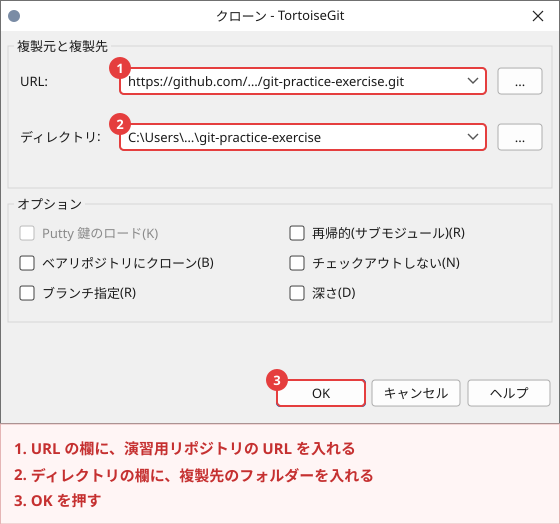

複製できたら、`git-practice-exercise` フォルダを開いて、次のものがあることを確かめよう。

- `practice` フォルダ
- `practice` フォルダの中の `sample-menu.txt`(体験②で使う)

`sample-menu.txt` には、最初から次の3行が書いてあるよ。

```
ランチのメニュー
カレーライス
うどん
```

これ以降の操作は、すべて `git-practice-exercise` フォルダの中で行う。

> [!TIP]
> **復習**
>
> - 自分のブランチの名前は、「自分の（　　　）/好きな（　　　）の名前」にする
> - 体験①と②では、PR を作るだけで、（　　　）はしない
> - 体験③だけは、取り込み先を（　　　）ではなく、②のブランチにする
>
> <details>
> <summary>答えを見る</summary>
>
> 1. イニシャル、フルーツ
> 2. マージ
> 3. `main`
>
> </details>

## 2. 体験①: 新しいファイルで PR を作る

新しいファイルを作って、自分のブランチで記録し、GitHub に送って、PR を作る。
最後に、PR の URL をスマホに送って、他の人が見られることを確かめるよ。

### 手順1: main をプルする

作業を始める前に、`main` を最新にしておく。
共有の置き場所では、ほかの人が先に変更していることがあるからね。06章で学んだプルを使う。

1. `git-practice-exercise` フォルダの中の何もない場所で右クリックして、TortoiseGit → Pull...(プル)を選ぶ
2. 取り込み元(Remote)が `origin`、リモートブランチが `main` になっていることを確かめて、OK を押す

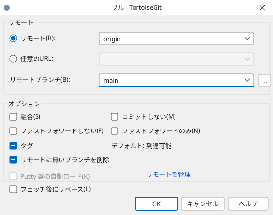

「すでに最新」のような表示が出たら、そのままでいい。取り込む新しい記録がなかった、ということだよ。

### 手順2: ブランチを切る

自分専用のブランチを作る。04章と同じ操作だよ。

1. `git-practice-exercise` フォルダの中の何もない場所で右クリックして、TortoiseGit → Create Branch...(ブランチを作成)を選ぶ
2. 名前の欄(Branch)に、自分のブランチ名(例: `ks/banana`)を入力する
3. 基点(元になる所)が `HEAD (main)` になっていることを確かめる
4. 「新しいブランチに切り替える」(Switch to new branch)にチェックを入れる
5. OK を押す

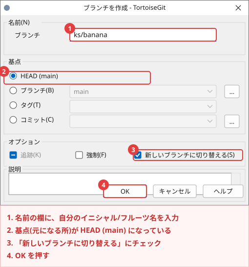

これで、自分のブランチに切り替わった。ここから先の変更は、自分のブランチに記録されて、`main` は変わらないよ。

> [!TIP]
> **復習**
>
> - 作業を始める前に、`main` を（　　　）して、最新にしておく
> - ブランチを作るときは、基点が（　　　）になっていることを確かめる
> - 「新しいブランチに切り替える」にチェックを入れると、作ったブランチに（　　　）
>
> <details>
> <summary>答えを見る</summary>
>
> 1. プル
> 2. `HEAD (main)`(`main`)
> 3. 切り替わる
>
> </details>

### 手順3: ファイルを作る

`practice` フォルダの中に、新しいファイルを作る。

1. `git-practice-exercise` フォルダの中の `practice` フォルダを開く
2. 右クリックして「新規作成」から「テキスト ドキュメント」を選ぶ
3. 名前を `wishlist-ks.txt` にする(`ks` は自分のイニシャルに変える)
4. ファイルを開いて、「100万円あったら欲しいもの」を5つ書く。1行に1つずつ、改行で区切る
5. 上書き保存して、閉じる

たとえば、次のように書く。中身は自由に決めていいよ。

```
ゲーミングPC
世界一周の旅行
大きなテレビ
おいしいお肉
新しい自転車
```

名前の最後が `.txt.txt` になっていないか、確かめてね。見えないときは、02章で学んだ「ファイル名拡張子」の設定を使おう。

### 手順4: 差分を確かめて、コミットする

ファイルを作っただけでは、まだ記録されていない。コミットで記録する。
その前に、TortoiseGit が新しいファイルをどう扱っているかを確かめよう。

**まず、アイコンを見る。** `practice` フォルダと、作ったファイルのアイコンに、小さなマークが付いているよ。

- フォルダーに付いた赤い「!」: 記録していない変更がある(環境によっては、付かないこともある)
- ファイルに付いた青い「?」: Git がまだ知らない、新しいファイル

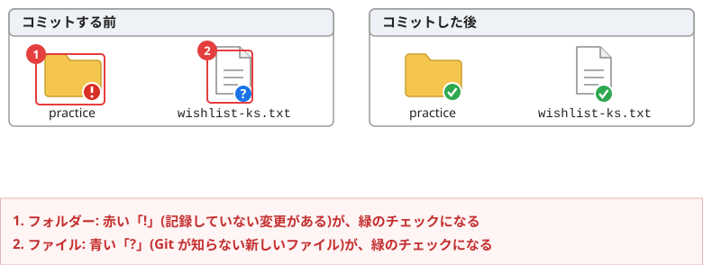

アイコンが変わっていないときは、フォルダーを開いて、F5 キーで画面を更新してみてね。

**次に、コミットする。**

1. `git-practice-exercise` フォルダの中の何もない場所で右クリックして、Git Commit -> "ks/banana"...(記録する)を選ぶ
2. 画面の左上の「コミット先」が、自分のブランチになっていることを確かめる
3. メッセージ欄に「ほしいものリストを追加」と書く
4. 一覧に、作ったファイル(`practice/wishlist-ks.txt`)が出ていることを確かめて、チェックを入れる
5. コミット(Commit)ボタンを押す

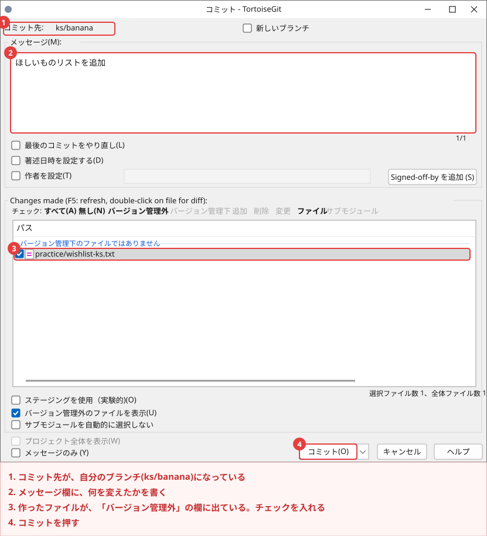

一覧の「バージョン管理外」という表示は、「このファイルは、まだ Git が記録していない」という意味だよ。コミットすると、記録の対象になる。

コミットが終わったら、アイコンをもう一度見よう。フォルダーもファイルも、緑のチェックに変わっているはずだよ。「記録済みで、変更はない」という印なんだ。

**最後に、何を記録したのかを、差分で確かめる。**

1. `git-practice-exercise` フォルダの中の何もない場所で右クリックして、TortoiseGit → Show log(ログを表示)を選ぶ
2. 一番上の記録(いまコミットした記録)を選ぶ
3. 下の一覧に出た `practice/wishlist-ks.txt` を、ダブルクリックする

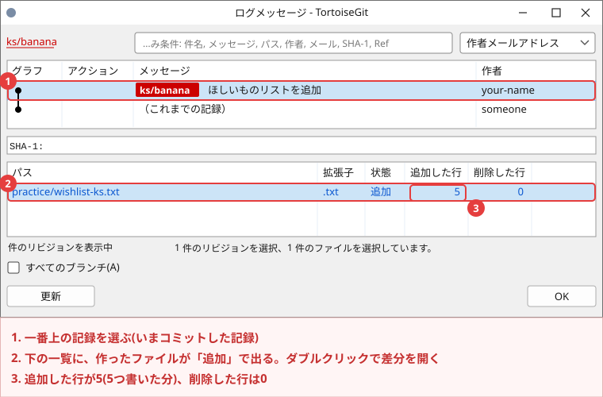

差分の画面が開く。左の「変更前」には何もなく、右の「変更後」に、書いた5行が緑色で並んでいれば、意図どおりに記録できているよ。

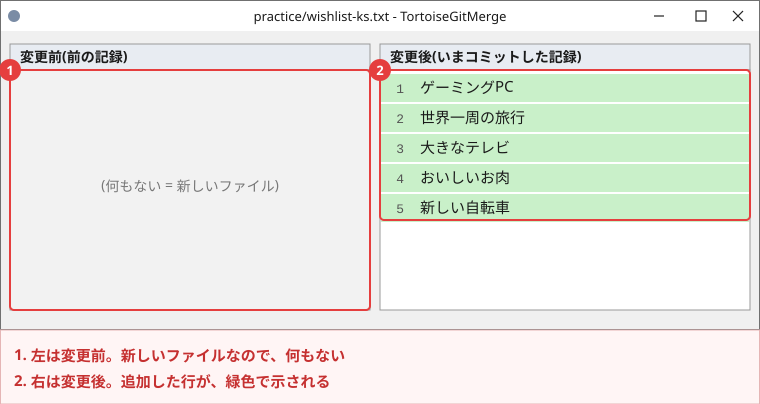

新しいファイルは、すべての行が「追加された行」になるんだ。

> [!TIP]
> **復習**
>
> - まだ記録していない新しいファイルには、青い（　　　）のアイコンが付く
> - コミットして記録済みになると、アイコンは緑の（　　　）に変わる
> - 新しく作ったファイルの差分では、すべての行が（　　　）色で示される
>
> <details>
> <summary>答えを見る</summary>
>
> 1. 「?」
> 2. チェック
> 3. 緑
>
> </details>

### 手順5: 自分のブランチをプッシュする

記録を GitHub に送る。送り先は、**必ず自分のブランチ**にする。

07章で学んだとおり、`main` に直接送ると、みんなが見る完成版に、作りかけの内容が混ざってしまう。送る前に、送り先を確かめる習慣をつけよう。

1. `git-practice-exercise` フォルダの中の何もない場所で右クリックして、TortoiseGit → Push...(プッシュ)を選ぶ
2. ローカル(Local)が、自分のブランチ(例: `ks/banana`)になっていることを確かめる。**`main` になっていないか、必ず見る**
3. リモート(Remote)の欄の、送り先のブランチ名も、自分のブランチ(例: `ks/banana`)になっていることを確かめる
4. 宛先のリモートが `origin` になっていることを確かめて、OK を押す

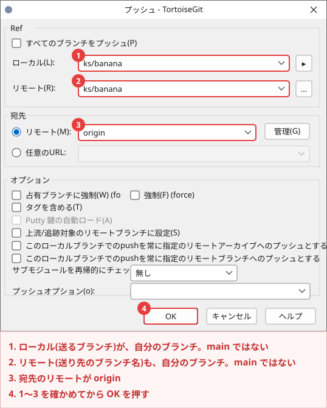

初めてプッシュするときは、GitHub へのサインインを求められることがある。画面の案内に従って、GitHub にサインインしよう。ユーザー名を聞かれたら、環境構築で確認した、自分の GitHub のユーザー名を入れる。

プッシュが終わると、成功したことを示す画面が出る。閉じてかまわないよ。

> [!TIP]
> **復習**
>
> - プッシュの前に、送るブランチが自分のブランチで、（　　　）ではないことを確かめる
> - `main` に直接送ると、みんなが見る（　　　）に、作りかけの内容が混ざってしまう
>
> <details>
> <summary>答えを見る</summary>
>
> 1. `main`
> 2. 完成版
>
> </details>

### 手順6: GitHub で PR を作る

ここからは、ブラウザで GitHub を操作する。

1. ブラウザで、演習用リポジトリのページを開く(準備の節にある、演習用リポジトリのリンク)
2. ページの上に、黄色い帯で、自分のブランチ名と「had recent pushes」と出ている。その右の緑のボタン「Compare & pull request」を押す

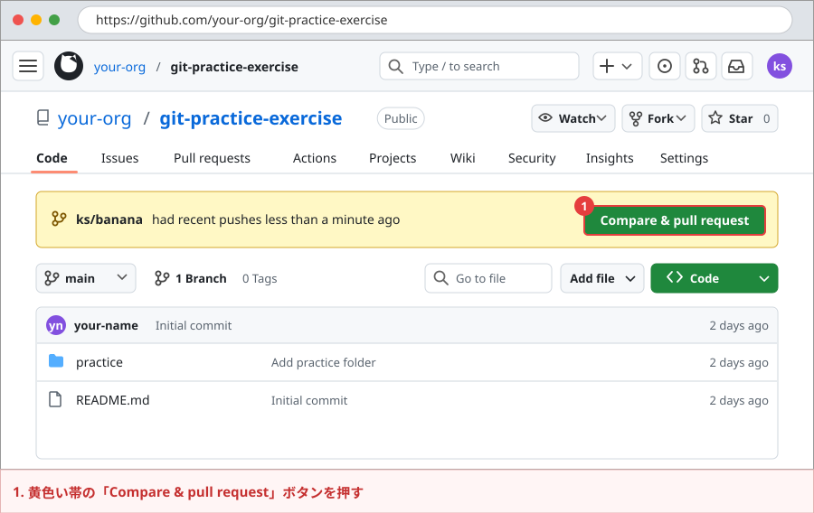

黄色い帯が出ていないときは、ページを更新してみよう。それでも出なければ、「Pull requests」のタブを開いて、「New pull request」を押し、自分のブランチを選ぶ方法もあるよ。

PR を作る画面が開く。次の順に確かめて、入力する。

1. `base` が `main`(取り込み先)になっている
2. `compare` が自分のブランチ(取り込みたい内容)になっている
3. タイトルの欄に、次のタイトルを入れる(`ks` は自分のイニシャルに変える)
4. 説明の欄に、次の説明を貼る
5. 緑の「Create pull request」ボタンを押す

タイトル:

```
演習①: wishlist-ks.txt を追加
```

説明:

```
演習①のPRです。
practice/wishlist-ks.txt を新規作成しました。

---
【講師向け】確認後の後片付け
1. PRのページ下部の「Close pull request」を押す
2. 「Delete branch」を押して、ブランチを削除する
```

説明は、下の「講師向け」の部分も含めて、そのまま貼ってね。

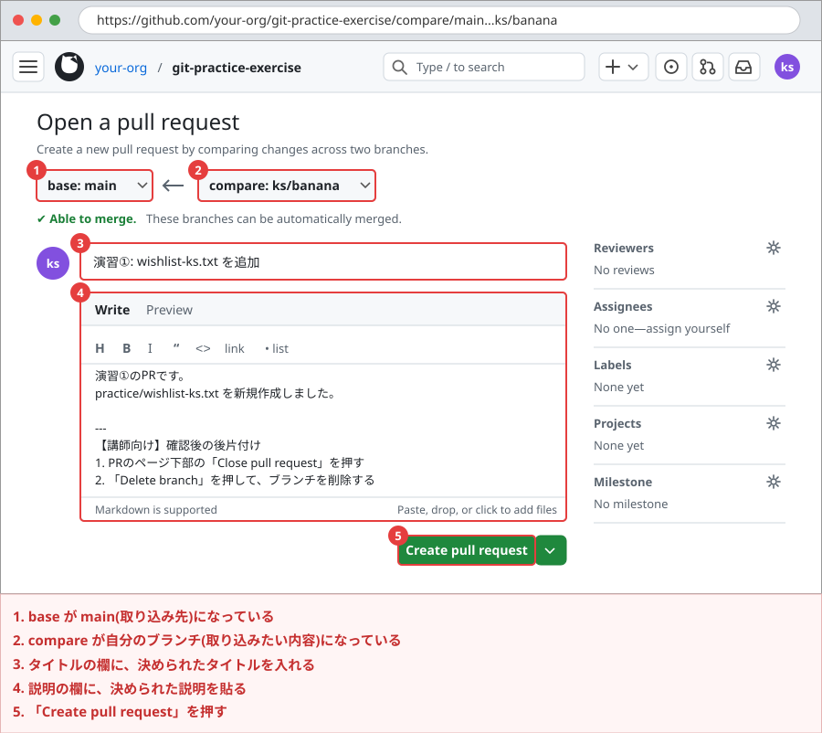

PR ができて、そのページが開く。タイトルの下に、緑の「Open」と出ているよ。

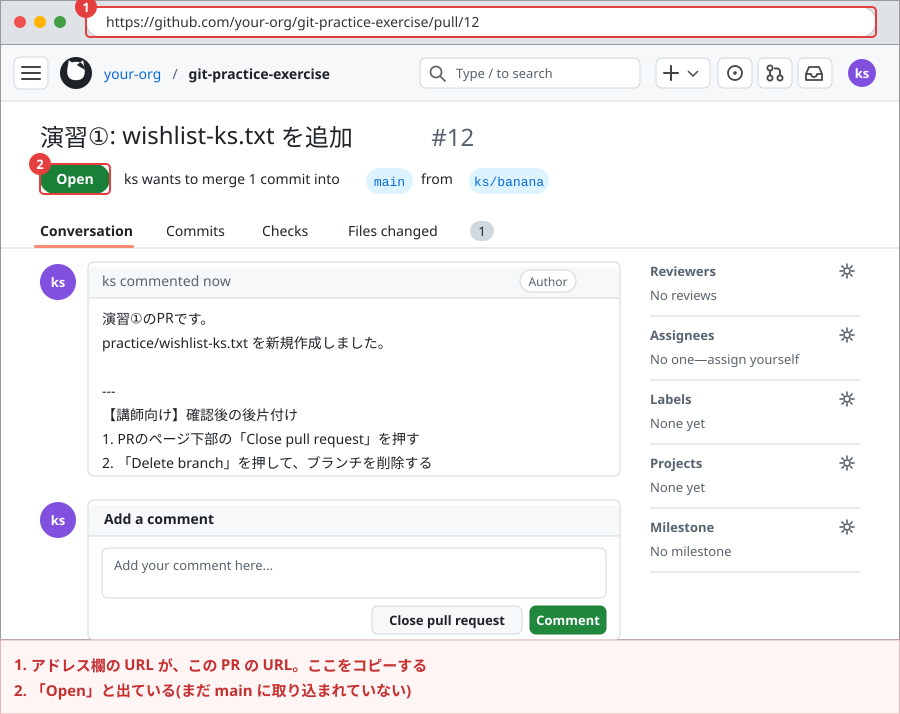

PR を作っただけでは、`main` は変わらない。この PR は、マージしないよ。

> [!TIP]
> **復習**
>
> - PR を作る画面では、`base` が取り込み先、`compare` が（　　　）になる
> - PR を作った直後は、（　　　）と出ていて、まだ `main` には取り込まれていない
> - 体験①の PR は、（　　　）しない
>
> <details>
> <summary>答えを見る</summary>
>
> 1. 取り込みたい内容(自分のブランチ)
> 2. Open
> 3. マージ
>
> </details>

### 手順7: PR の URL をスマホに送って、見てみる

PR のページには、URL がある。他の人があなたの変更を見られることを、確かめよう。

1. PR のページのアドレス欄をクリックして、URL をコピーする(Ctrl + C)
2. LINE やメールなどで、自分のスマホに URL を送る
3. スマホで URL を開く

スマホで、PR のタイトルと説明が見えたら成功だよ。
「Files changed」を開くと、書いたファイルの内容が緑の行で見える。

あなたのパソコンを使っていない人も、この URL を開けば、同じ PR の画面を見られる。変更を、ほかの人に見てもらえる、ということだね。

> [!TIP]
> **復習**
>
> - PR のページの URL は、ブラウザの（　　　）欄からコピーできる
> - URL を送れば、他の人も同じ PR の（　　　）を見られる
>
> <details>
> <summary>答えを見る</summary>
>
> 1. アドレス
> 2. ページ(変更内容)
>
> </details>

## 3. 体験②: 既存のファイルを書き換えて PR を作る

すでにあるファイルを書き換えて、PR を作る。
PR の画面で、書き換える前と後が、どう見えるかを確かめるよ。

### 手順1: main に戻って、プルする

体験②のブランチも、`main` から作る。まず `main` に切り替えて、プルする。

1. `git-practice-exercise` フォルダの中の何もない場所で右クリックして、TortoiseGit → Switch/Checkout...(ブランチを切り替え)を選ぶ
2. ブランチ(Branch)の欄で `main` を選んで、OK を押す
3. 体験①の手順1と同じ方法で、`main` をプルする

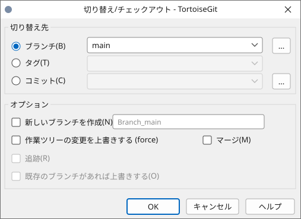

`main` に切り替えると、体験①で作った `wishlist-ks.txt` が、見えなくなる。
消えたわけではないよ。`wishlist-ks.txt` は、`ks/banana` ブランチの記録の中にあって、`main` にはまだ入っていないんだ。04章で学んだ、ブランチごとに内容が違う、という仕組みだね。

### 手順2: ブランチを切る

1. TortoiseGit → Create Branch...(ブランチを作成)を選ぶ
2. 名前の欄に、体験①のブランチ名の後ろに `-2` を付けた名前(例: `ks/banana-2`)を入力する
3. 基点が `HEAD (main)` になっていることを確かめる
4. 「新しいブランチに切り替える」にチェックを入れて、OK を押す

画面は、体験①の手順2と同じだよ。

### 手順3: ファイルを書き換えて、コミットする

1. `practice` フォルダの中の `sample-menu.txt` を開く
2. 2行目の「カレーライス」を、自分の好きな食べ物に書き換える(例: ラーメン)
3. 上書き保存して、閉じる
4. 右クリックして、Git Commit -> "ks/banana-2"...(記録する)を選ぶ
5. 画面の左上の「コミット先」が、自分のブランチ(例: `ks/banana-2`)になっていることを確かめる
6. メッセージ欄に「sample-menu.txt の2行目を書き換え」と書く
7. 一覧の `practice/sample-menu.txt` にチェックが入っていることを確かめて、コミット(Commit)を押す

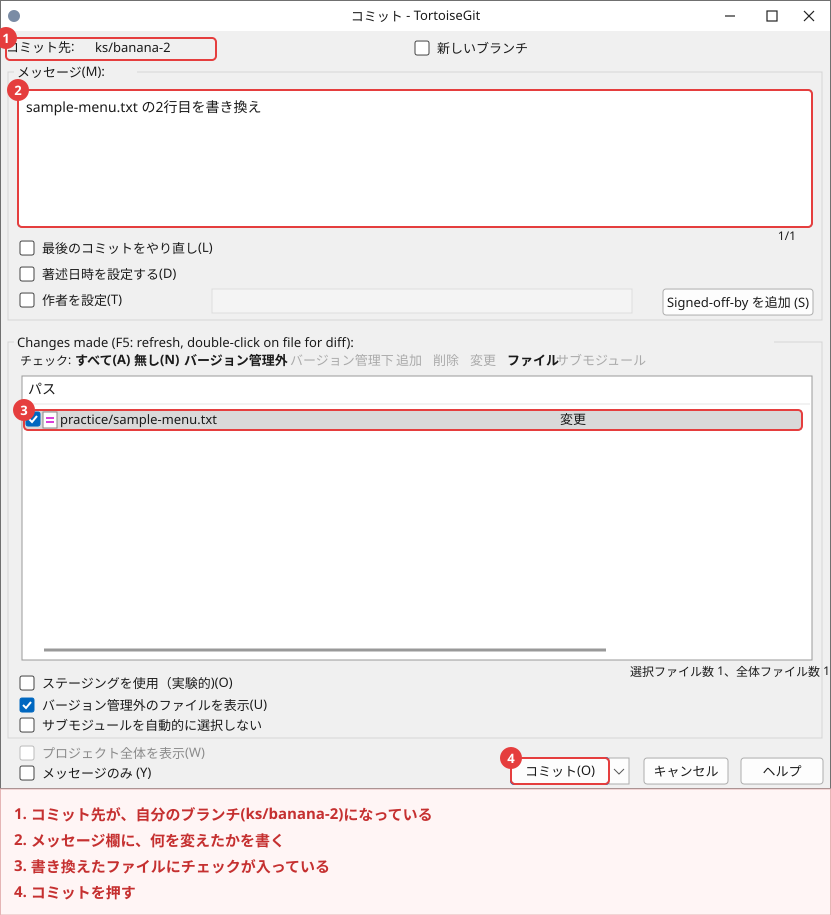

今回は、すでに記録されているファイルを書き換えたので、一覧には、新しいファイルのときの「バージョン管理外」の表示は出ない。変更したファイルとして、一覧に並ぶよ。
アイコンは、赤い「!」になっていたはずだよ。コミットすると、緑のチェックに戻る。

> [!TIP]
> **復習**
>
> - 体験②のブランチも、（　　　）から作る
> - `main` に切り替えると、体験①で作ったファイルが見えなくなるのは、そのファイルが（　　　）にまだ入っていないから
> - すでに記録されているファイルを書き換えたときのアイコンは、赤い（　　　）になる
>
> <details>
> <summary>答えを見る</summary>
>
> 1. `main`
> 2. `main`
> 3. 「!」
>
> </details>

### 手順4: プッシュして、PR を作る

体験①の手順5、手順6と同じ操作だよ。違うところだけ、確かめよう。

**プッシュ**

- ローカル(Local)と、リモート(Remote)のブランチ名が、どちらも自分のブランチ(例: `ks/banana-2`)になっていることを確かめて、OK を押す。`main` になっていないか、必ず見る

**PR を作る**

- 演習用リポジトリのページを開いて、「Compare & pull request」を押す
- `base` が `main`、`compare` が自分のブランチ(例: `ks/banana-2`)になっていることを確かめる
- タイトルと説明は、次のとおり。`ks` は自分のイニシャルに変える

タイトル:

```
演習②: sample-menu.txt の2行目を書き換え
```

説明:

```
演習②のPRです。
practice/sample-menu.txt の2行目を書き換えました。

---
【講師向け】確認後の後片付け
1. PRのページ下部の「Close pull request」を押す
2. 「Delete branch」を押して、ブランチを削除する
```

- 「Create pull request」を押す

体験②も、この PR はマージしない。

### 手順5: PR で差分を確かめる

PR のページで、「Files changed」のタブを開く。
書き換えた前と後が、行ごとに色で示されているよ。

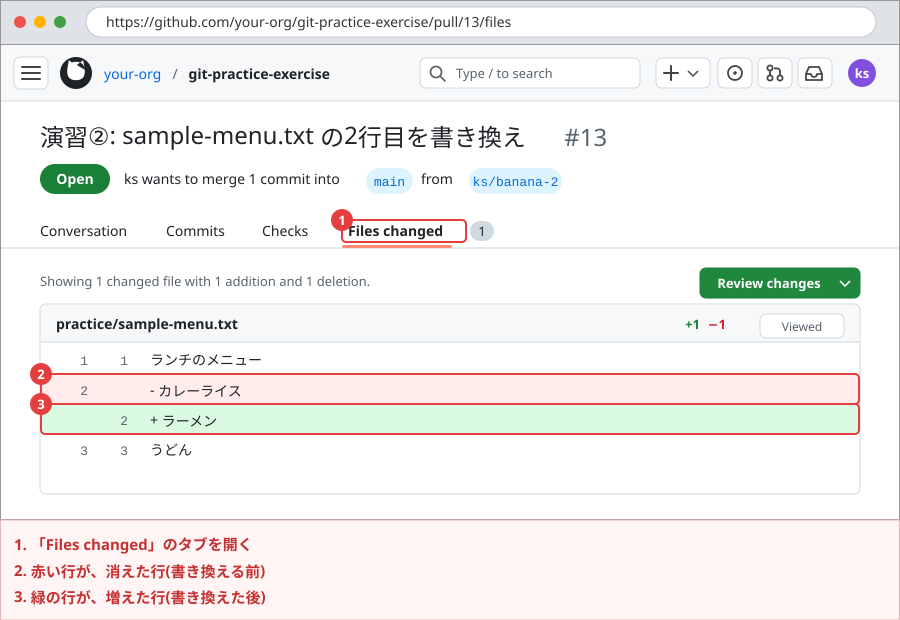

- 赤い行: 消えた行。書き換える前の内容
- 緑の行: 増えた行。書き換えた後の内容

体験①では、新しいファイルだったので、すべての行が緑だった。
既存のファイルを書き換えると、「何を、何に変えたのか」が、赤と緑の対で見えるんだ。確認する人は、この画面を見て、変更の中身を確かめるよ。

> [!TIP]
> **復習**
>
> - PR の変更内容は、（　　　）のタブで見られる
> - 書き換える前の内容は（　　　）の行、書き換えた後の内容は緑の行で示される
> - 体験②の PR も、（　　　）しない
>
> <details>
> <summary>答えを見る</summary>
>
> 1. Files changed
> 2. 赤
> 3. マージ
>
> </details>

## 4. 体験③: ②のブランチから伸ばして、②に取り込む

②のブランチからさらにブランチを作って、PR を作る。
今度は、取り込み先を `main` ではなく、②のブランチにして、マージまでやるよ。

### 手順1: ②のブランチから、ブランチを切る

体験②が終わった時点で、あなたは②のブランチ(`ks/banana-2`)に切り替わったままのはずだよ。
体験③のブランチは、この②のブランチを基点にして作る。

1. TortoiseGit → Create Branch...(ブランチを作成)を選ぶ
2. 名前の欄に、`ks/banana-3` のように、後ろに `-3` を付けた名前を入力する
3. **基点が `HEAD (ks/banana-2)` になっていることを確かめる。** `HEAD (main)` ではない
4. 「新しいブランチに切り替える」にチェックを入れて、OK を押す

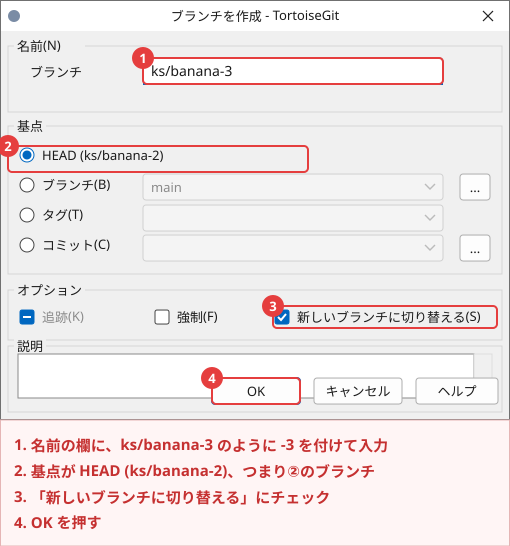

基点が `HEAD (main)` になっているときは、いまのブランチが②ではない。OK を押す前に、Switch/Checkout... で②のブランチに切り替えてから、やり直そう。

②のブランチから伸ばしたので、③のブランチには、②で書き換えた内容が入っているよ。`sample-menu.txt` を開いて、2行目が書き換わっていることを確かめてみよう。

### 手順2: 1行追加して、コミットする

1. `practice` フォルダの中の `sample-menu.txt` を開く
2. 4行目に、「デザート: 」と好きなデザートを書き足す(例: `デザート: プリン`)
3. 上書き保存して、閉じる
4. 右クリックして、Git Commit -> "ks/banana-3"...(記録する)を選ぶ
5. コミット先が、自分のブランチ(例: `ks/banana-3`)になっていることを確かめる
6. メッセージ欄に「sample-menu.txt に4行目を追加」と書いて、`practice/sample-menu.txt` にチェックが入っていることを確かめて、コミット(Commit)を押す

### 手順3: プッシュする

体験①の手順5と同じ操作だよ。ローカル(Local)と、リモート(Remote)のブランチ名が、どちらも自分のブランチ(例: `ks/banana-3`)になっていることを確かめて、OK を押す。`main` になっていないか、必ず見る。

> [!TIP]
> **復習**
>
> - 体験③のブランチは、（　　　）のブランチを基点にして作る
> - ブランチを作る画面では、基点が `HEAD (ks/banana-2)` になっていることを（　　　）
> - ③のブランチには、②で書き換えた内容が（　　　）
>
> <details>
> <summary>答えを見る</summary>
>
> 1. ②(`ks/banana-2`)
> 2. 確かめる
> 3. 入っている
>
> </details>

### 手順4: 取り込み先を②のブランチにして、PR を作る

ここが体験③の大事なところだよ。

PR を作る画面は、取り込み先(`base`)が、最初は `main` になっている。
そのままだと、「③の変更を `main` に取り込んでください」という PR になってしまう。取り込み先を、②のブランチに切り替えてから作るよ。

1. 演習用リポジトリのページを開いて、「Compare & pull request」を押す
2. `base: main` と書かれたボタンを押す。ブランチの一覧が開く
3. 一覧から、②のブランチ(例: `ks/banana-2`)を選ぶ

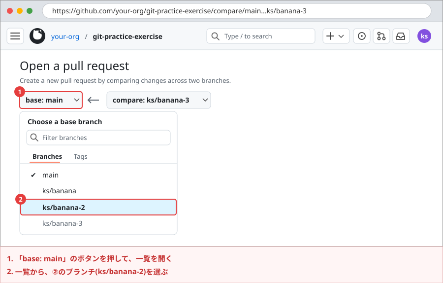

切り替えたら、次の順に確かめて、入力する。

1. `base` が、②のブランチ(例: `ks/banana-2`)になっている。**`main` ではない**
2. `compare` が、③のブランチ(例: `ks/banana-3`)になっている
3. タイトルの欄に、次のタイトルを入れる
4. 説明の欄に、次の説明を貼る
5. 緑の「Create pull request」ボタンを押す

タイトル:

```
演習③: sample-menu.txt に4行目を追加
```

説明(説明の中の `ks/banana-2` は、自分の②のブランチ名に変える):

```
演習③のPRです。
practice/sample-menu.txt に4行目を追加しました。
取り込み先は、②のブランチ(ks/banana-2)です。

---
【講師向け】確認後の後片付け
1. 「Delete branch」を押して、ブランチを削除する
```

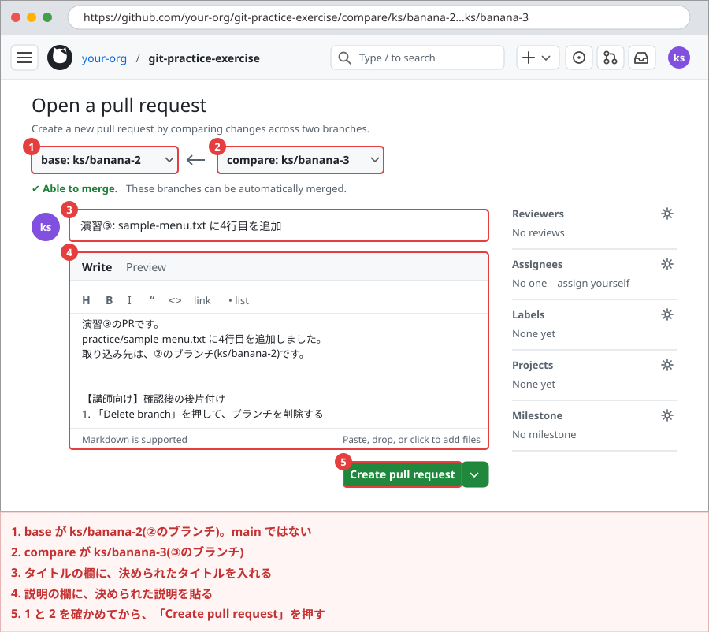

> [!WARNING]
> `base` が `main` のまま PR を作ってしまったときは、マージのボタンを押さずに、講師に伝えてね。
> `main` への取り込みは、この教材では行わないよ。

> [!TIP]
> **復習**
>
> - PR を作る画面の `base` は、最初は（　　　）になっている
> - 体験③では、`base` を（　　　）のブランチに切り替えてから、PR を作る
>
> <details>
> <summary>答えを見る</summary>
>
> 1. `main`
> 2. ②(`ks/banana-2`)
>
> </details>

### 手順5: ②のブランチにマージする

PR ができて、ページが開く。ここでは、PR を確認して、取り込み先である②のブランチにマージする。

1. タイトルの下の文が、「into ②のブランチ from ③のブランチ」(例: `into ks/banana-2 from ks/banana-3`)になっていることを確かめる
2. ページの下の、緑の「Merge pull request」ボタンを押す
3. 確認の表示に変わるので、緑の「Confirm merge」ボタンを押す

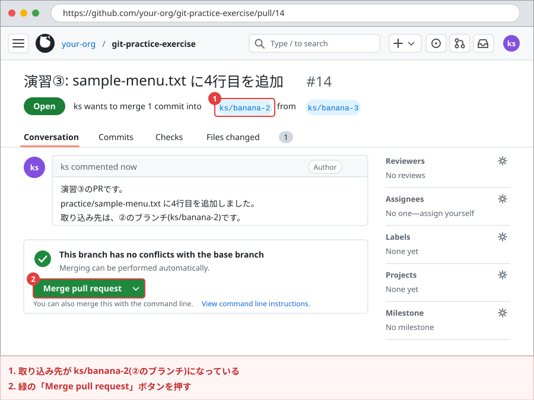

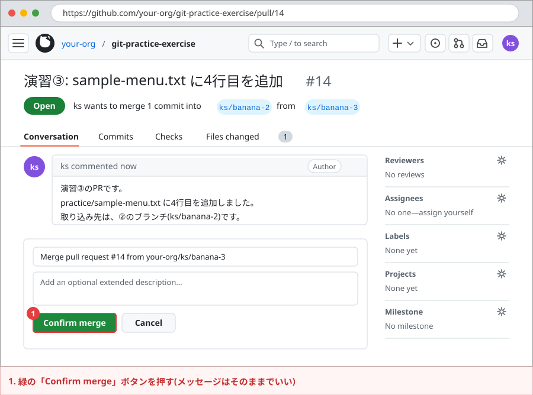

マージが終わると、タイトルの下の表示が、紫の「Merged」に変わる。

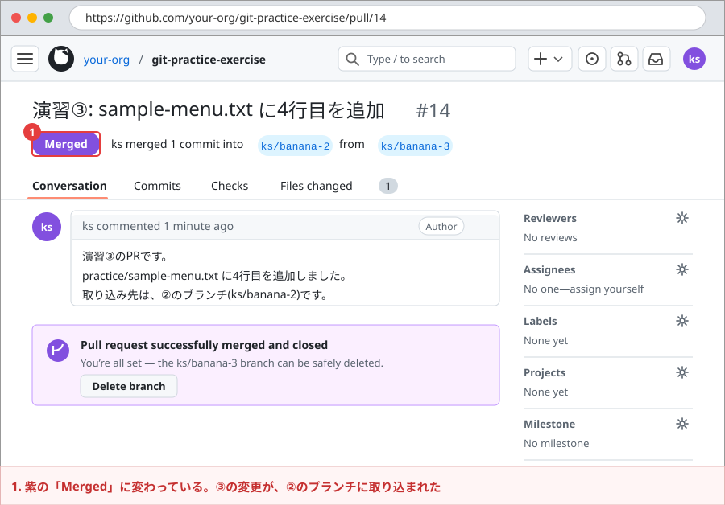

これで、③の変更が、②のブランチに取り込まれた。
05章で学んだマージを、GitHub の画面から行ったんだ。

「Delete branch」のようなボタンも出るけれど、押さなくていい。

### 手順6: ②の PR で、③の変更が増えたか確かめる

体験②で作った PR のページを、もう一度開いてみよう。

1. 演習用リポジトリの「Pull requests」のタブから、体験②の PR(「演習②: ...」)を開く
2. 「Files changed」のタブを開く

体験③で追加した4行目(`デザート: ...`)が、緑の行で増えているよ。
②のブランチに、③の変更が取り込まれたので、②の PR の変更内容にも加わったんだ。

> [!TIP]
> **復習**
>
> - マージが終わると、PR のタイトルの下の表示が、紫の（　　　）に変わる
> - ②のブランチにマージすると、②の PR の変更内容にも、③の変更が（　　　）
>
> <details>
> <summary>答えを見る</summary>
>
> 1. Merged
> 2. 加わる(増える)
>
> </details>

## 体験のまとめ

3つの体験で、仕事でよくある流れを一通りやってみたね。

| 体験 | やったこと | 取り込み先 |
|---|---|---|
| ① | 新しいファイルを作って、PR を作った。URL をスマホで開いた | `main`(マージしない) |
| ② | 既存のファイルを書き換えて、PR を作った。差分を見た | `main`(マージしない) |
| ③ | ②のブランチから伸ばして、PR を作り、マージした | ②のブランチ(マージした) |

- 作業は、自分専用のブランチで行う。`main` には直接送らない
- ブランチをプッシュして、GitHub で PR を作ると、他の人が確認できる
- PR の取り込み先は、選べる

作った PR は、講師が確認するよ。
